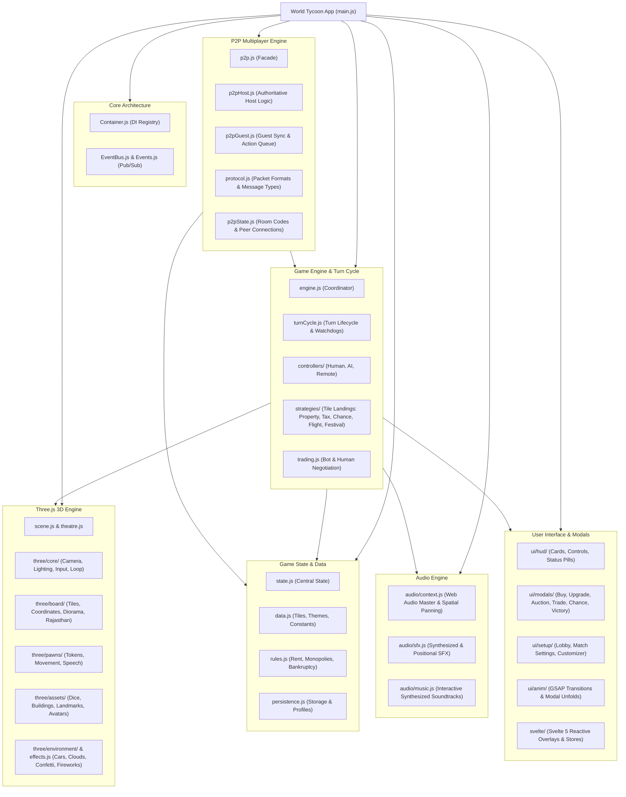
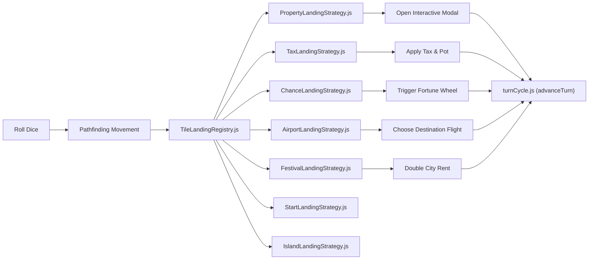
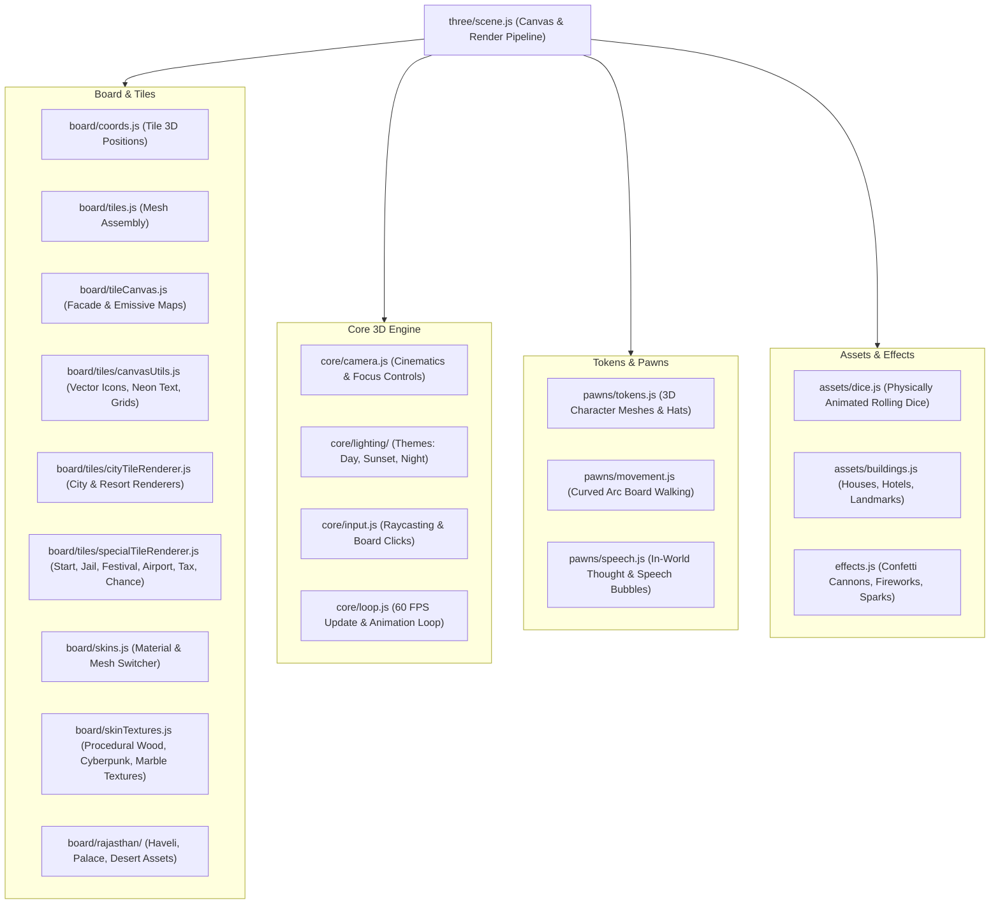
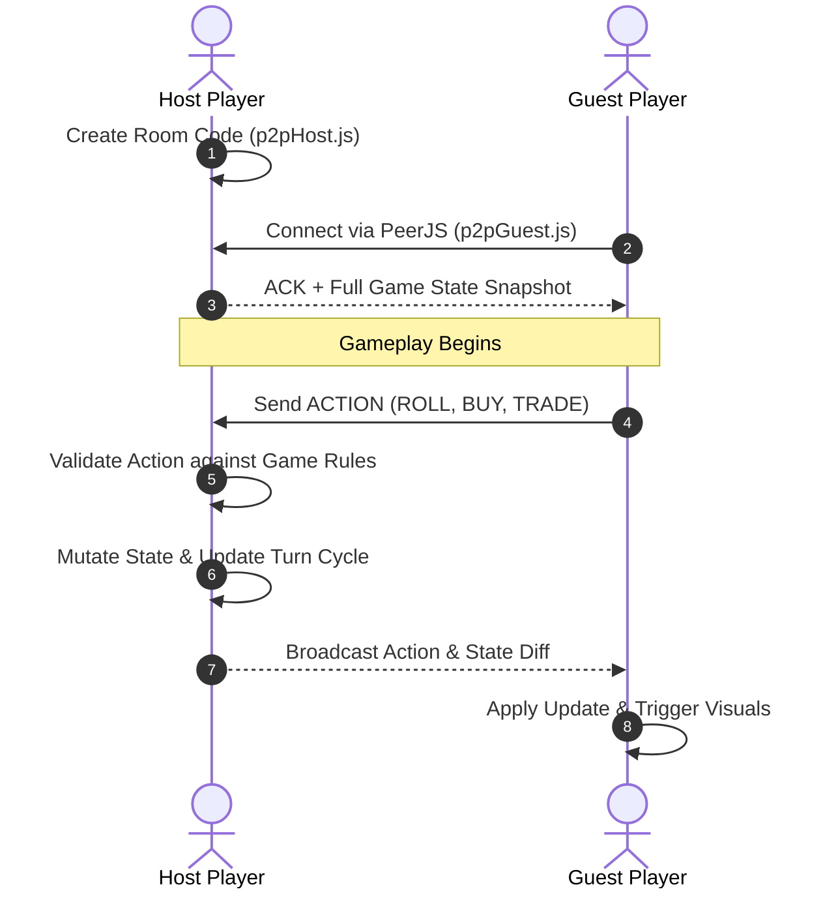

# World Tycoon: Codebase Architecture & Mindmap

> [!NOTE]
> This guide is the official architectural mindmap and quick-reference index for the World Tycoon codebase.
> **Rule**: Always check this file first when navigating the code. Whenever modules or architecture changes happen, update this document immediately.

---

## 1. High-Level System Mindmap

---

## 2. Directory & Module Navigation

### 2.1 Core Orchestration & State
- [`world-tycoon/src/main.js`](world-tycoon/src/main.js): App bootstrap, event wiring, canvas initialization, and lifecycle coordination.
- [`world-tycoon/src/core/Container.js`](world-tycoon/src/core/Container.js): Lightweight dependency injection container.
- [`world-tycoon/src/core/EventBus.js`](world-tycoon/src/core/EventBus.js): Central publish-subscribe message broker.
- [`world-tycoon/src/core/Events.js`](world-tycoon/src/core/Events.js): Global event name constants (`TURN_START`, `TILE_LANDED`, `DICE_ROLLED`, `MONOPOLY_TRIGGERED`).
- [`world-tycoon/src/game/state.js`](world-tycoon/src/game/state.js): Primary source of truth (`gameState`, `matchSettings`, `debugState`, `cycleGameSpeed`).
- [`world-tycoon/src/game/data.js`](world-tycoon/src/game/data.js): Tile metadata for World and Rajasthan boards, avatar definitions, color groups, and Chance tables.
- [`world-tycoon/src/game/rules.js`](world-tycoon/src/game/rules.js): Business rules for rent multipliers, full color group detection, side monopolies, and debt liquidation.
- [`world-tycoon/src/game/trading.js`](world-tycoon/src/game/trading.js): Trade evaluations, cash valuations, and AI bot counter-offers.

---

### 2.2 Turn Cycle & Landing Strategies
The turn cycle and tile interactions follow the Strategy and Factory patterns:

- [`world-tycoon/src/game/engine.js`](world-tycoon/src/game/engine.js): Coordinates turn transitions and state validation.
- [`world-tycoon/src/game/engine/turnCycle.js`](world-tycoon/src/game/engine/turnCycle.js): Turn timer watchdog, double rolls, turn advance, and game-over checks.
- [`world-tycoon/src/game/engine/auction.js`](world-tycoon/src/game/engine/auction.js): Sold property public auction engine with dynamic 3-option bidding increments, 5-second countdown timer reset on bid, sequential queue management for liquidated properties, AI bot valuation, and P2P synchronization.
- [`world-tycoon/src/game/engine/landings.js`](world-tycoon/src/game/engine/landings.js): High-level landing dispatcher.
- [`world-tycoon/src/game/engine/strategies/ITileLandingStrategy.js`](world-tycoon/src/game/engine/strategies/ITileLandingStrategy.js): Base strategy interface.
- [`world-tycoon/src/game/engine/strategies/PropertyLandingStrategy.js`](world-tycoon/src/game/engine/strategies/PropertyLandingStrategy.js): Handles buy, buyout, upgrade, rent transfers, and multiplayer rent debt liquidation synchronization (`ACTION_RENT_DEBT`) with host AFK safety fallback.
- [`world-tycoon/src/game/engine/strategies/TaxLandingStrategy.js`](world-tycoon/src/game/engine/strategies/TaxLandingStrategy.js): Net-worth and flat tax calculations with property liquidation support (`openSellCitiesModal`) preventing premature bankruptcy.
- [`world-tycoon/src/game/engine/strategies/ChanceLandingStrategy.js`](world-tycoon/src/game/engine/strategies/ChanceLandingStrategy.js): Card draws and fortune spins.
- [`world-tycoon/src/game/engine/strategies/AirportLandingStrategy.js`](world-tycoon/src/game/engine/strategies/AirportLandingStrategy.js): World tour and flight mechanics.
- [`world-tycoon/src/game/engine/strategies/FestivalLandingStrategy.js`](world-tycoon/src/game/engine/strategies/FestivalLandingStrategy.js): Festival host selection and rent doubling.

---

### 2.3 Player Controllers (Polymorphic Design)
- [`world-tycoon/src/game/controllers/IPlayerController.js`](world-tycoon/src/game/controllers/IPlayerController.js): Base contract for turn action dispatch.
- [`world-tycoon/src/game/controllers/HumanPlayerController.js`](world-tycoon/src/game/controllers/HumanPlayerController.js): Hooks into DOM HUD buttons and touch inputs.
- [`world-tycoon/src/game/controllers/AIPlayerController.js`](world-tycoon/src/game/controllers/AIPlayerController.js): Heuristic decisions for buying, upgrading, and trading.
- [`world-tycoon/src/game/controllers/RemotePlayerController.js`](world-tycoon/src/game/controllers/RemotePlayerController.js): Proxies actions over WebRTC from remote players.
- [`world-tycoon/src/game/controllers/PlayerControllerFactory.js`](world-tycoon/src/game/controllers/PlayerControllerFactory.js): Instantiates correct controller based on slot config.

---

### 2.4 Three.js 3D Graphics Engine

- [`world-tycoon/src/three/scene.js`](world-tycoon/src/three/scene.js): Scene management, renderer initialization, shadow map configuration, and unified facade re-exporting `setEmpireSpotlight`.
- [`world-tycoon/src/three/board/tiles/cityTileRenderer.js`](world-tycoon/src/three/board/tiles/cityTileRenderer.js): 2D Canvas tile texture rendering for cities and resorts, featuring high-contrast direct on-tile Owner Ribbons (avatar emoji, bold capitalized name, P1-P4 slot pill badge) and elegant muted "FOR SALE" pills when unowned.
- [`world-tycoon/src/three/board/tileCanvas.js`](world-tycoon/src/three/board/tileCanvas.js): Texture and emissive map generator for board tiles, including night and sunset emissive passes for owner ribbons.
- [`world-tycoon/src/three/board/tiles.js`](world-tycoon/src/three/board/tiles.js): 3D board tile blocks with dynamic building placement, enhanced owner base pedestals (level 0 flagpole plinth, level 1-3 foundation slab & deck, level 4 grand champion slab with 4 gold corner clips), and local player signature rim glow.
- [`world-tycoon/src/three/board/highlights.js`](world-tycoon/src/three/board/highlights.js): Highlight rings, runway targeting beacons, monopoly set halos, and the 3D Empire Spotlight service (`setEmpireSpotlight`) for territory illumination and non-owned dimming.
- [`world-tycoon/src/three/core/camera.js`](world-tycoon/src/three/core/camera.js): Dynamic camera modes (isometric overview, pawn chase, modal zoom).
- [`world-tycoon/src/three/core/lighting/themes.js`](world-tycoon/src/three/core/lighting/themes.js): Lighting presets for Day, Sunset, and Cyberpunk/Night.
- [`world-tycoon/src/three/pawns/movement.js`](world-tycoon/src/three/pawns/movement.js): Hop and walk animations around board corners.
- [`world-tycoon/src/three/assets/dice.js`](world-tycoon/src/three/assets/dice.js): 3D dice rolling with face rotation calculations.
- [`world-tycoon/src/three/board/rajasthan/assembly.js`](world-tycoon/src/three/board/rajasthan/assembly.js): Rajasthan edition diorama with desert palace and animated camels.

---

### 2.5 Multiplayer & P2P Networking

- [`world-tycoon/src/network/p2p.js`](world-tycoon/src/network/p2p.js): Unified multiplayer API facade.
- [`world-tycoon/src/network/protocol.js`](world-tycoon/src/network/protocol.js): Packet schemas and action constants (`ACTION_RENT_DEBT`, `ACTION_SELL_CITY_FOR_RENT`, `ACTION_SETTLE_RENT`, `ACTION_BANKRUPTCY`, `ACTION_BUYOUT_CITY`).
- [`world-tycoon/src/network/p2pHost.js`](world-tycoon/src/network/p2pHost.js): Authoritative host room server, validates turns, broadcasts snapshots, maintains signaling heartbeats (`startHostHeartbeat`), auto-reconnects on tab sleep, and handles room ID collisions.
- [`world-tycoon/src/network/p2pGuest.js`](world-tycoon/src/network/p2pGuest.js): Client synchronization, remote action queuing, 14-second watchdog connection timeout, progressive handshake status, and fast WebRTC ICE failure detection.
- [`world-tycoon/src/network/p2pState.js`](world-tycoon/src/network/p2pState.js): Connection status, peer references, room metadata, Anycast STUN servers list, Metered enterprise TURN relays (`ICE_SERVERS` with UDP, TCP, and TLS TURNS on ports 80/443), and heartbeat timers.
- [`world-tycoon/src/network/p2pReconnect.js`](world-tycoon/src/network/p2pReconnect.js): Resilient P2P session resurrection (`reconnectHostRoom`), guest 30-second disconnect grace window with live countdown (`startGuestReconnectGracePeriod`), and autonomous AI bot takeover fallback (`convertRemotePlayersToBots`). Freezes turn clocks, timers, rolls, and property actions via `networkState.isReconnecting` to prevent desyncs during peer recovery.

---

### 2.6 User Interface, Modals & HUD
- **Svelte 5 Declarative Architecture (`src/svelte/`) (Standard: Always develop UI in Svelte, no raw .js modal DOM manipulation)**:
  - `stores/hudStore.js`: Central reactive store for turn phases, timer, roll states, game speed, toasts, and audio volume.
  - `stores/bannerStore.js`: Central reactive store for declarative in-game event banners (Player Eliminated, Hostile Takeover, Doubles, Boarding Pass, Monopoly).
  - `stores/modalStore.js`: Declarative modal state slices for all 20 game modals (Buy City, Upgrade City, Sell Cities, Auction, Portfolio, Rules, Victory, Wardrobe, Trade, Buyout, Inspector, Chance Wheel, Festival Boost, Resume Match, Disconnect Notice, Confirm Exit, Reconnect Grace, Leaderboard, Monopoly Celebration, Update Alert) with automatic DOM synchronization (`syncModalDom`).
  - `stores/lobbyStore.js`: Pre-game match setup store for player slots, host/peer badges, roles, and character selection.
  - `hud/`: Svelte HUD components (`TopBar.svelte`, `StatusPill.svelte`, `PlayerCards.svelte`, `GameHud.svelte`, `GameBanners.svelte`) mounted at `#svelte-hud-mount` with single-source-of-truth declarative DOM and top offset positioning.
  - `components/`: Reusable Svelte 5 UI primitives (`ActionChipShell.svelte` encapsulating bottom-center floating chip styling and transitions for `BuyCityModal`, `UpgradeCityModal`, and `BuyoutModal`).
  - `modals/`: Declarative modal views (`ResumeMatchModal.svelte`, `DisconnectNoticeModal.svelte`, `ConfirmExitLobbyModal.svelte`, `ReconnectGraceModal.svelte`, `BuyCityModal.svelte`, `UpgradeCityModal.svelte`, `SellCitiesModal.svelte`, `AuctionModal.svelte`, `PortfolioModal.svelte`, `RulesModal.svelte`, `VictoryModal.svelte`, `WardrobeModal.svelte`, `TradeModal.svelte`, `BuyoutModal.svelte`, `InspectorModal.svelte`, `ChanceWheelModal.svelte`, `FestivalBoostModal.svelte`, `LeaderboardModal.svelte`, `MonopolyCelebrationModal.svelte`, `UpdateAlertModal.svelte`, `ModalsRoot.svelte`) mounted at `#svelte-modals-mount`.
    - **Session & Network Modals**: Modern spatial glassmorphic modals (`ResumeMatchModal.svelte`, `DisconnectNoticeModal.svelte`, `ConfirmExitLobbyModal.svelte`, `ReconnectGraceModal.svelte`) with dynamic radial halos, zero text truncation, reactive timer chips, and instant solo AI takeover fallbacks.
    - **Competitive & Celebration Modals**: Declarative rich presentations (`LeaderboardModal.svelte`, `MonopolyCelebrationModal.svelte`, `UpdateAlertModal.svelte`) featuring reactive wealth rankings, SVG Net Worth trajectory timeline, side-by-side tangible deed cards, and semver update comparison.
    - **In-Flow Playfield Action Chips**: Fast-paced routine decisions (`UpgradeCityModal.svelte`, `BuyCityModal.svelte`, `BuyoutModal.svelte`) built on top of the reusable `<ActionChipShell />` component anchored at bottom-center (`fixed bottom-4 sm:bottom-6 left-1/2 -translate-x-1/2 z-[1000]`) with zero full-screen screen dimmers, allowing uninterrupted 3D board visibility, instant 1-click upgrades without redundant prompts, and clear price/rent progression.
    - **Executive Property Dossier (`InspectorModal.svelte`)**: Sleek dark glassmorphic card (`bg-slate-950/95`) with dynamic atmospheric district gradient glow, spinning 3D diorama canvas, high-contrast ownership strip with owner color tags, telemetry-styled rent progression table with glowing active tier ring, and financial intel (Build Cost; mortgage permanently removed).
    - **Property Level Metadata (`rules.js`)**: Clean Code single-source-of-truth helper (`getPropertyLevelMetadata`) delivering unified labels, icons, and tier badges across inspector cards, portfolios, and HUD dialogs.
    - **Chance Result Toast**: Celebratory fortune wheel payout (`modal-chance-result` in `ChanceWheelModal.svelte`) renders as a floating top notification chip (`fixed top-16 sm:top-20 left-1/2 -translate-x-1/2 z-[1100]`) rather than a full-screen blackout.
  - `lobby/`: Declarative setup roster (`PlayerSetupCards.svelte`).
- **HUD Controllers**:
  - [`world-tycoon/src/ui/hud/controls.js`](world-tycoon/src/ui/hud/controls.js): Roll button, fast-forward toggle, and turn controls dispatching to `hudStore`.
  - [`world-tycoon/src/ui/hud/cards.js`](world-tycoon/src/ui/hud/cards.js): Player cash cards and status bars dispatching to `hudStore` without dual-rendering DOM collisions; rendered in Svelte by `PlayerCards.svelte` with interactive hover, focus, and touch empire spotlighting (`setEmpireSpotlight`).
  - [`world-tycoon/src/ui/hud/statusPill.js`](world-tycoon/src/ui/hud/statusPill.js): Turn phase notification banner dispatching unconditionally to `hudStore` with full DOM ID alignment (`#hud-status-pill`, `#hud-status-pill-dot`, `#hud-status-pill-text`).
- **Modals (Svelte-Driven)**:
  - [`world-tycoon/src/ui/modals/buyCity.js`](world-tycoon/src/ui/modals/buyCity.js): Property purchase prompt (driven by Svelte `BuyCityModal.svelte`).
  - [`world-tycoon/src/ui/modals/buyoutCity.js`](world-tycoon/src/ui/modals/buyoutCity.js): Acquisition buyout of opponent property (driven by Svelte `BuyoutModal.svelte`; features synchronized multi-peer takeover banner, dramatic Web Audio takeover brass/impact SFX, and 1.5s Three.js cinematic camera panning zoom).
  - [`world-tycoon/src/ui/modals/upgradeCity.js`](world-tycoon/src/ui/modals/upgradeCity.js): Constructing villas, hotels, and landmarks (driven by Svelte `UpgradeCityModal.svelte`).
  - [`world-tycoon/src/ui/modals/sellRent.js`](world-tycoon/src/ui/modals/sellRent.js): Liquidating cities to satisfy rent debts or tax/fine deficits, with multi-peer debt phase synchronizer and bank debtor support (driven by Svelte `SellCitiesModal.svelte`).
  - [`world-tycoon/src/ui/modals/auction.js`](world-tycoon/src/ui/modals/auction.js): Sold property public auction engine with dynamic 3-option bidding increments, 5-second countdown timer reset on bid, sequential queue management for liquidated properties, AI bot valuation, and P2P synchronization (driven by Svelte `AuctionModal.svelte` floating action chip with amber gradient `from-amber-500 to-amber-700`).
  - [`world-tycoon/src/ui/modals/inspector.js`](world-tycoon/src/ui/modals/inspector.js): Property inspection and player portfolio view (driven by Svelte `InspectorModal.svelte` and declarative `PortfolioModal.svelte`; modernized spatial glassmorphism card with dynamic district ambient glow, 3D rotating diorama preview, structured rent progression schedule, real-time upgrade/downgrade actions, and pure declarative dataflow via `buildInspectorSliceData`; dual-DOM innerHTML hacking retired).
  - [`world-tycoon/src/ui/modals/system.js`](world-tycoon/src/ui/modals/system.js): Official game rules and help guide (driven by Svelte `RulesModal.svelte`).
  - [`world-tycoon/src/ui/modals/victory.js`](world-tycoon/src/ui/modals/victory.js): Match recap, accolades, net worth chart, and stars rewards (driven by Svelte `VictoryModal.svelte`).
  - [`world-tycoon/src/ui/modals/trade.js`](world-tycoon/src/ui/modals/trade.js): Player-to-player property negotiation and bot proposals (driven by Svelte `TradeModal.svelte`).
  - [`world-tycoon/src/ui/modals/chanceWheel.js`](world-tycoon/src/ui/modals/chanceWheel.js): Interactive spinning wheel for fortune cards with ticker needle physics and 2.2s celebration popup (driven by Svelte `ChanceWheelModal.svelte`).
  - [`world-tycoon/src/ui/modals/chanceCanvas.js`](world-tycoon/src/ui/modals/chanceCanvas.js): 2D Canvas wheel rendering with right-side-up tangential badge orientation and vector icons.
  - [`world-tycoon/src/ui/modals/festivalBoost.js`](world-tycoon/src/ui/modals/festivalBoost.js): World festival rent boost and 3D breathing highlights (driven by Svelte `FestivalBoostModal.svelte`).
  - [`world-tycoon/src/templates/modals/network-alerts.html`](world-tycoon/src/templates/modals/network-alerts.html): Network & session alerts (Resume Match dialog, Disconnection notice, Confirm Exit to Lobby; modernized to spatial dark glassmorphic cards with zero header clipping, radial atmospheric halos, and high-contrast player rosters).
- **Setup & Wardrobe**:
  - [`world-tycoon/src/ui/setup/setupRoom.js`](world-tycoon/src/ui/setup/setupRoom.js): Lobby staging room and player configuration.
  - [`world-tycoon/src/ui/setup/matchSettingsUI.js`](world-tycoon/src/ui/setup/matchSettingsUI.js): Match customization panel and human-only color collision locking.
  - [`world-tycoon/src/ui/setup/playerCustomization.js`](world-tycoon/src/ui/setup/playerCustomization.js): Player color/archetype configuration and `ensureBotsHaveUniqueColors()` dynamic bot re-rolling.
  - [`world-tycoon/src/ui/wardrobe.js`](world-tycoon/src/ui/wardrobe.js): Unlockable hats, dice skins, and pedestals (driven by Svelte `WardrobeModal.svelte` with reactive slide-in drawer classes, live 3D character viewport centering on left stage, and smooth title action suppression).
- **Animation Engine (`src/ui/anim/`)**:
  - [`world-tycoon/src/ui/anim/events.js`](world-tycoon/src/ui/anim/events.js): Animation facade routing events to specialized submodules.
  - [`world-tycoon/src/ui/anim/banners.js`](world-tycoon/src/ui/anim/banners.js): Doubles comic banners, boarding pass zooms, monopoly ribbons, hostile takeover stamps, and high-impact multi-peer player elimination banners (`animatePlayerEliminatedBanner`).
  - [`world-tycoon/src/ui/anim/celebrations.js`](world-tycoon/src/ui/anim/celebrations.js): Victory tally breakdown, festival pot golden rain fountain, and GO salary bill streams.
  - [`world-tycoon/src/ui/anim/jail.js`](world-tycoon/src/ui/anim/jail.js): Island detention iron bars slam and jailbreak scatter animations.
  - [`world-tycoon/src/ui/anim/interactions.js`](world-tycoon/src/ui/anim/interactions.js): Active turn switch spring punch, chance deck FLIP draw, HUD card spring absorb, bankruptcy quake, building upgrade bounce, trade handshake pop, and dice slingshot pullback.
- **Debug Suite**:
  - [`world-tycoon/src/game/debug/ui.js`](world-tycoon/src/game/debug/ui.js): Debug drawer controller and shortcuts.
  - [`world-tycoon/src/game/debug/debugPanelTemplate.js`](world-tycoon/src/game/debug/debugPanelTemplate.js): Modularized QA drawer template markup.

---

### 2.7 Audio Subsystem
- [`world-tycoon/src/game/audio/context.js`](world-tycoon/src/game/audio/context.js): Shared Web Audio `AudioContext`, master volume slider state, and 3D panner nodes.
- [`world-tycoon/src/game/audio/sfx.js`](world-tycoon/src/game/audio/sfx.js): Procedural synthesis for dice rolls, cash counts, button taps, error chirps, hostile takeover brass impacts, and dramatic player elimination motifs (sub-bass impact gong, shatter transient noise burst, and descending doom chord arpeggio).
- [`world-tycoon/src/game/audio/music.js`](world-tycoon/src/game/audio/music.js): Algorithmic background music arrangements that adapt to match tension.

---

### 2.8 Build Tooling, Deployment & Analytics
- [`world-tycoon/tools/assemble-html.js`](world-tycoon/tools/assemble-html.js): Assembles modal templates into `index.html`.
- [`world-tycoon/tools/build-css.js`](world-tycoon/tools/build-css.js): Fast PostCSS and Tailwind compiler.
- [`vercel.json`](vercel.json) & [`world-tycoon/vercel.json`](world-tycoon/vercel.json): Vercel CI deployment configuration with automated Vite production builds.
- **Vercel Web Analytics (`@vercel/analytics`)**: Integrated into [`world-tycoon/src/main.js`](world-tycoon/src/main.js) via `inject()` and `track()`, capturing real-time page views and semantic game telemetry (`match_started`, `match_victory`) over `eventBus`.
- [`world-tycoon/package.json`](world-tycoon/package.json): NPM run scripts (`test`, `dev`, `build`, `typecheck`).

---

### 2.9 Visual Polish & Performance Standards (v1.0.7 - v1.0.8)
- **Atmospheric Sky & Horizon (`src/three/effects.js`, `src/three/environment/clouds.js`)**: Softened radial horizon gradient (`#ffffff` through `#dbeafe` to `#cbd5e1`) and 75% cloud opacity, allowing the 3D diorama board to pop with high contrast.
- **Semantic Single-Hue UI Gradients (`better-colors`)**: Normalized all modal headers, banners, and HUD pills into single-hue ramps: Emerald (`from-emerald-600 to-teal-700`) for empire/cash/festivals, Warm Amber (`from-amber-500 to-amber-700`) for auctions/stars, Deep Sky (`from-sky-600 to-indigo-700`) for rules/world tour, and Rose (`from-rose-600 to-rose-800`) for hostile buyouts/disconnections.
- **Performance-First Solid Glass Surfaces (`fixing-motion-performance`)**: Completely eliminated heavy `backdrop-filter: blur(...)` across all persistent HUD chips, player cards, status pills, and tooltips in [`src/style.css`](world-tycoon/src/style.css) in favor of high-performance solid surfaces (`rgba(255, 255, 255, 0.96-0.98)` and `rgba(15, 23, 42, 0.96)`) with optical borders, preventing GPU fill-rate throttling over the WebGL canvas.
- **High-Readability Horizontal Chance Wheel (`src/ui/modals/chanceCanvas.js`, `src/game/data.js`)**: De-cluttered chance wheel wedges to an alternating luxury palette (`#1e293b` and `#312e81`) with gold rim, placing 100% horizontal, upright white prize cards on every slice so players never have to tilt their heads or read inverted text.
- **Decisive Upgrade City Architecture (`src/ui/modals/upgradeCity.js`, `src/svelte/modals/UpgradeCityModal.svelte`)**: Replaced confusing multi-step alert re-prompts with a prominent high-contrast Treasury card (`YOUR TREASURY`, `UPGRADE COST`, `REMAINING BALANCE`), clear rent leap cards, and decisive one-click upgrade actions that conclude the turn without secondary alert boxes.
