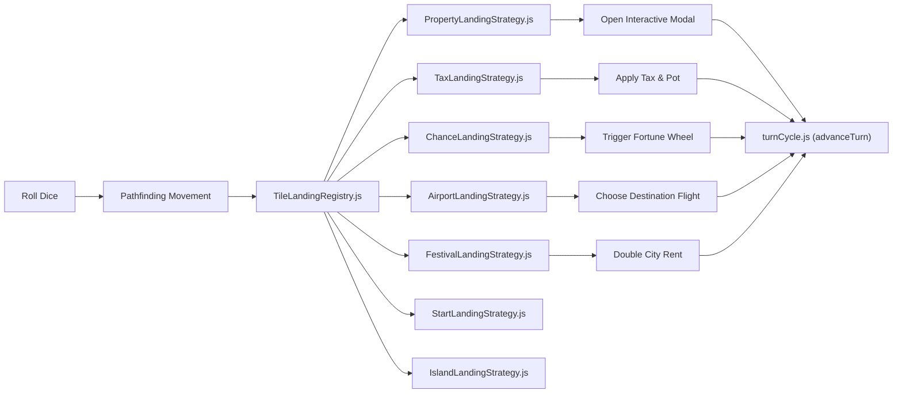
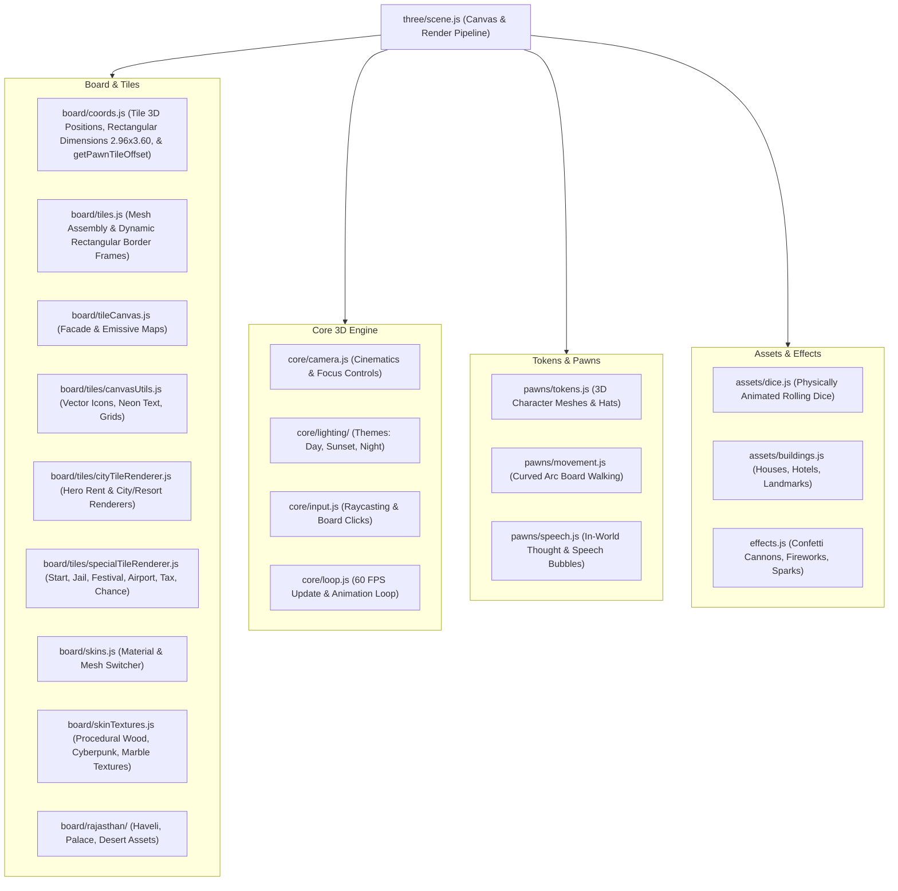
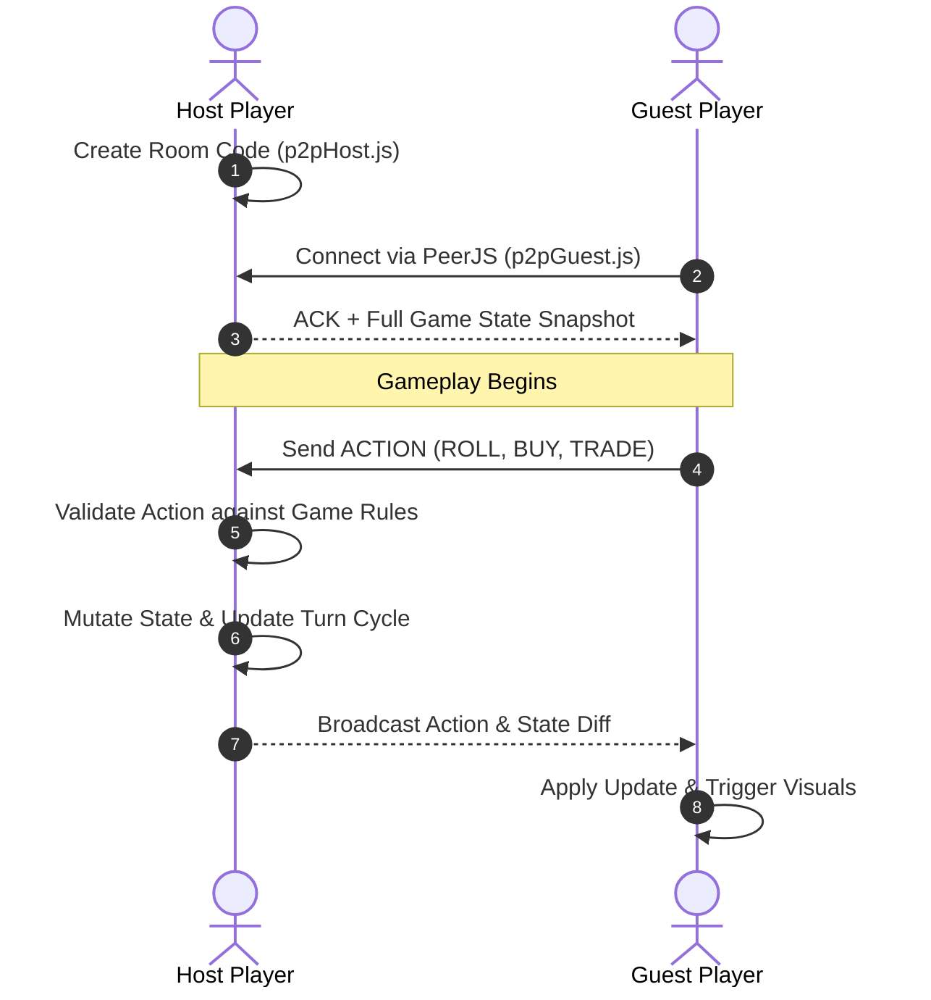

# World Tycoon: Codebase Architecture & Mindmap

> [!NOTE]
> This guide is the official architectural mindmap and quick-reference index for the World Tycoon codebase.
> **Rule**: Always check this file first when navigating the code. Whenever modules or architecture changes happen, update this document immediately.
>
> ### 🛡️ Mandatory Engineering Standards:
> 1. **Always Code in Svelte**: All UI views, screens, HUD overlays, modals, drawers, cards, banners, and tooltips MUST be authored in Svelte 5 (`src/svelte/`). Never write new vanilla JS DOM manipulations, imperative `innerHTML` templates, or manual `document.getElementById` styling hacks.
> 2. **Minimize JS Usage to Absolute Minimum**: Plain JavaScript is strictly restricted to non-DOM core logic: deterministic game rules, state containers, Three.js WebGL rendering pipelines, Web Audio procedural synthesis, and P2P binary networking. All data touching the screen MUST flow through reactive Svelte stores (`modalStore`, `hudStore`, `lobbyStore`, `bannerStore`).
> 3. **Code in Least Code (Extreme Simplicity)**: Write the shortest, cleanest, and most concise implementation possible. Eliminate boilerplate, leverage Svelte declarative bindings (`bind:`, `$state`, `$derived`), eliminate duplicate state, and ruthlessly purge dead code.
> 4. **Multiplayer-First Parity (Mandatory)**: Every feature, mechanic, modal, and state transition MUST be architected, configured, and tested for both Host and Guest perspectives (packet protocol, broadcast relay, execution, and state sync). Zero desyncs.

---

## 1. High-Level System Mindmap

```mermaid
flowchart TD
    App["World Tycoon App (main.js)"]
    
    subgraph Core ["Core Architecture"]
        Container["Container.js (DI Registry)"]
        EventBus["EventBus.js & Events.js (Pub/Sub)"]
    end

    subgraph State ["Game State & Data"]
        GState["state.js (Central State)"]
        GData["data.js (Tiles, Themes, Constants)"]
        GRules["rules.js (Rent, Monopolies, Bankruptcy)"]
        GPersist["persistence.js (Storage & Profiles)"]
    end

    subgraph Engine ["Game Engine & Turn Cycle"]
        GEngine["engine.js (Coordinator)"]
        TurnCycle["turnCycle.js (Turn Lifecycle & Watchdogs)"]
        Controllers["controllers/ (Human, AI, Remote)"]
        Strategies["strategies/ (Tile Landings: Property, Tax, Chance, Flight, Festival)"]
        Trading["trading.js (Bot & Human Negotiation)"]
    end

    subgraph Graphics ["Three.js 3D Engine"]
        Scene["scene.js & theatre.js"]
        ThreeCore["three/core/ (Camera, Lighting, Input, Loop)"]
        Board["three/board/ (Tiles, Coordinates, Diorama, Rajasthan)"]
        Pawns["three/pawns/ (Tokens, Movement, Speech)"]
        Assets["three/assets/ (Dice, Buildings, Landmarks, Avatars)"]
        Env["three/environment/ & effects.js (Clouds, Confetti, Fireworks, Balloons)"]
    end

    subgraph Network ["P2P Multiplayer Engine"]
        P2P["p2p.js (Facade)"]
        P2PHost["p2pHost.js (Authoritative Host Logic)"]
        P2PGuest["p2pGuest.js (Guest Sync & Action Queue)"]
        P2PProto["protocol.js (Packet Formats & Message Types)"]
        P2PState["p2pState.js (Room Codes & Peer Connections)"]
    end

    subgraph UI ["User Interface & Modals"]
        UIHUD["ui/hud/ (Cards, Controls, Status Pills)"]
        UIModals["ui/modals/ (Buy, Upgrade, Auction, Trade, Chance, Victory)"]
        UISetup["ui/setup/ (Lobby, Match Settings, Customizer)"]
        UIAnim["ui/anim/ (GSAP Transitions & Modal Unfolds)"]
        SvelteLayer["svelte/ (Svelte 5 Reactive Overlays & Stores)"]
    end

    subgraph Audio ["Audio Engine"]
        AudioCtx["audio/context.js (Web Audio Master & Spatial Panning)"]
- `SFX` ([`audio/sfx.js`](world-tycoon/src/game/audio/sfx.js) -> [`sfx/uiSfx.js`](world-tycoon/src/game/audio/sfx/uiSfx.js), [`sfx/boardSfx.js`](world-tycoon/src/game/audio/sfx/boardSfx.js), [`sfx/eventSfx.js`](world-tycoon/src/game/audio/sfx/eventSfx.js)): Synthesized & Positional SFX dispatcher facade.
        Music["audio/music.js (Interactive Synthesized Soundtracks)"]
    end

    App --> Core
    App --> State
    App --> Engine
    App --> Graphics
    App --> Network
    App --> UI
    App --> Audio

    Engine --> State
    Engine --> Graphics
    Engine --> Audio
    Engine --> UI
    Network --> State
    Network --> Engine
```

---

## 2. Directory & Module Navigation

### 2.1 Core Orchestration & State
- [`world-tycoon/src/main.js`](world-tycoon/src/main.js): App bootstrap, event wiring, canvas initialization, and lifecycle coordination.
- [`world-tycoon/src/core/Container.js`](world-tycoon/src/core/Container.js): Lightweight dependency injection container.
- [`world-tycoon/src/core/EventBus.js`](world-tycoon/src/core/EventBus.js): Central publish-subscribe message broker.
- [`world-tycoon/src/core/Events.js`](world-tycoon/src/core/Events.js): Global event name constants (`TURN_START`, `TILE_LANDED`, `DICE_ROLLED`, `MONOPOLY_TRIGGERED`).
- [`world-tycoon/src/game/state.js`](world-tycoon/src/game/state.js): Primary source of truth (`gameState`, `matchSettings`, `debugState`, `cycleGameSpeed`).
- [`world-tycoon/src/game/data.js`](world-tycoon/src/game/data.js): Tile metadata for World and Rajasthan boards, avatar definitions, color groups, and Chance tables.
  - **Rajasthan Edition Rebalancing & Cultural Polish**:
    - Rebalanced all 22 cities and 2 resorts by real-world economic prominence, tourism prestige, and metropolitan GDP (Jaipur & Udaipur at Dark Blue $540k-$600k; Jodhpur, Amer & Neemrana at Green $450k-$480k; Kota & Ajmer elevated to Yellow $400k; Pali moved from $450k to Pink $260k; Rawatbhata at Light Blue $190k; Bharatpur & Alwar at Brown $120k-$140k).
    - Monotonic price progression strictly maintained across all 8 color sets.
    - Added rich cultural subtitles to every tile for Inspector dossiers and hover tooltips.
    - Updated corner tiles (`DESERT JAIL` on tile 8, `PUSHKAR FAIR` on tile 16, `ROYAL EXPRESS` on tile 24, and `ROYAL TAX` on tile 29).
    - Customized `RAJASTHAN_CHANCE_WHEEL_PRIZES` with the 7 distinctive Royal Fortune Cards: Amber Fort Vault (+$400K cash), Pushkar Fair Caravan (move to Tile 16, collect pot & trigger 2x rent boost), Heritage Trust Audit (-$200K tax into festival pool), Maharaja's Royal Architect (free Haveli house upgrade or $250K fallback grant), Thar Desert Sandstorm (Desert Jail detainment), Palace on Wheels Express (move to START for +$350K salary), and Magic Carpet Ride (`random_move` teleport to any random board tile; World edition adds Mystery Warp `random_move`).
    - Edition-aware Chance deck UI in `ChanceWheelModal.svelte` with `ROYAL FORTUNE DECK` header, crown crest, and royal decree buttons.
- [`world-tycoon/src/game/rules.js`](world-tycoon/src/game/rules.js): Business rules for rent multipliers, full color group detection (`ownsFullColorGroup`), near-monopoly threat detection (`checkNearMonopolyGroup`), side monopolies, debt liquidation, and buyout immunity (`isPropertyBuyoutImmune`).
- **Pacing & Hostile Takeover Balance Overhaul (4–5 Player Tuning)**:
  - **Bank Acquisition Tax (30% Sink)**: Hostile buyouts cost `2x base + houses`. Seller receives `1.4x base + houses`, while `0.6x base` (30% of base buyout fee) is burned directly as a municipal tax to curb inflation.
  - **2-Takeover Hard Cap (Protected Landmarks)**: Each property tracks `takeoverCount`. On the 2nd buyout, the property converts into a permanent Protected Landmark (`takeoverCount >= 2`) with buyout immunity, preventing endless cycling.
  - **Multi-House Construction (+2 Levels)**: Players and AI bots can upgrade up to 2 levels in a single visit if cash permits, accelerating properties to Level 4 (Skyscrapers) for natural immunity.
  - **Tuned Match Economy**: 4–5 player starting cash defaults to $1.5M (2–3 players keep $2M); passing START salary tuned to $250k and landing super bonus to $350k.
- **Team Mode (2v2 & 3v3 Alliance Engine)**:
  - [`world-tycoon/src/game/data.js`](world-tycoon/src/game/data.js): `TEAM_META` metadata defining Team Red (`#ef4444`) and Team Blue (`#3b82f6`).
  - [`world-tycoon/src/game/rules.js`](world-tycoon/src/game/rules.js): `isTeammate`, `getTeamMembers`, `calculateTeamNetWorth`, `validateTeamModeBalance` (strict 2v2 / 3v3 pre-start balance validator), team-aware `ownsFullColorGroup` (shared color groups across allies), `calculateTileRent` ($0 partner rent immunity), and victory evaluator (`quad_monopoly` with 4 required color groups, team line monopoly, team bankruptcy elimination).
  - [`world-tycoon/src/game/engine/strategies/PropertyLandingStrategy.js`](world-tycoon/src/game/engine/strategies/PropertyLandingStrategy.js): Teammate property handling ($0 rent, partner house building, hostile buyout immunity) and ally rent debt bailout support.
  - [`world-tycoon/src/game/state.js`](world-tycoon/src/game/state.js): `matchSettings.teamMode`, `player.teamId`, automatic assignment of team colors (`#ef4444` / `0xef4444` and `#3b82f6` / `0x3b82f6`) in `resetGameStateForNewMatch`, and syncing `PLAYER_THEMES` so tile flags and houses reflect team colors.
  - [`world-tycoon/src/ui/setup/matchSettingsUI.js`](world-tycoon/src/ui/setup/matchSettingsUI.js) & [`world-tycoon/src/svelte/lobby/MatchSettingsPanel.svelte`](world-tycoon/src/svelte/lobby/MatchSettingsPanel.svelte): `[ 👑 Solo FFA ]` vs `[ 🤝 Team Mode ]` match configuration selector with automatic team color propagation.
  - [`world-tycoon/src/ui/setup/playerCards.js`](world-tycoon/src/ui/setup/playerCards.js) & [`world-tycoon/src/svelte/lobby/PlayerSetupCards.svelte`](world-tycoon/src/svelte/lobby/PlayerSetupCards.svelte): Pure `lobbyStore` roster state sync (legacy HTML string builder removed); `PlayerSetupCards.svelte` and `HeroPreview.svelte` render all lobby cards, team toggle pills (`[ 🔴 RED ]` / `[ 🔵 BLUE ]`), and hero archetype controls declaratively.
  - [`world-tycoon/src/svelte/lobby/HeroPreview.svelte`](world-tycoon/src/svelte/lobby/HeroPreview.svelte): Dynamic color palette suppression in Team Mode (`{#if !state.isTeamMode}`), replaced by an active `🔴 TEAM RED` or `🔵 TEAM BLUE` badge pill, and blocking individual color swaps in `playerCustomization.js`.
  - [`world-tycoon/src/three/assets/avatars.js`](world-tycoon/src/three/assets/avatars.js): Strict Red and Blue 3D figurine generation in Team Mode (`charColor` 0xef4444 vs 0x3b82f6 on suit, lapels, sleeves, night aura, and pedestal glow ring), while preserving distinct archetype headwear and glasses for individual player identification.
  - [`world-tycoon/src/ui/hud/cards.js`](world-tycoon/src/ui/hud/cards.js) & [`world-tycoon/src/svelte/hud/PlayerCards.svelte`](world-tycoon/src/svelte/hud/PlayerCards.svelte): Spatial team HUD grouping local team players strictly on left column and opponent team players on right column, uniform Red (`#ef4444`) card theme for Team Red and Blue (`#3b82f6`) card theme for Team Blue, `🤝 ALLY` partner badge, and dynamic Team Net Worth pills with unclipped numeric metrics.
  - [`world-tycoon/test/teamMode.test.js`](world-tycoon/test/teamMode.test.js): Comprehensive unit test suite covering team detection, net worth, rent immunity, shared monopolies, quad monopoly win, 5-player balancing, unbalanced distribution rejection, uniform HUD team colors, color select locking, and 3D pawn team materials.
- [`world-tycoon/src/game/trading.js`](world-tycoon/src/game/trading.js): Trade evaluations, cash valuations, and AI bot counter-offers.

---

### 2.2 Turn Cycle & Landing Strategies
The turn cycle and tile interactions follow the Strategy and Factory patterns:



- [`world-tycoon/src/game/engine.js`](world-tycoon/src/game/engine.js): Coordinates turn transitions and state validation; restores active `auction` state and maintains `gameState.phase = 'AUCTION'` on guest peers during `FULL_STATE_SYNC` without triggering unintended turn advancements.
- [`world-tycoon/src/game/engine/turnCycle.js`](world-tycoon/src/game/engine/turnCycle.js): Turn timer watchdog, double rolls, turn advance, phase guards (`AUCTION`, `VICTORY`), and game-over checks.
- [`world-tycoon/src/game/engine/auction.js`](world-tycoon/src/game/engine/auction.js): Sold property public auction engine with dynamic 3-option bidding increments, 5-second countdown timer reset on bid, sequential queue management for liquidated properties, AI bot valuation and automated pass registration, full turn-phase synchronization (`gameState.phase = 'AUCTION'`), background timer suppression (`cancelAllGameTimers`, `clearAuctionTimers`), early conclusion detection when non-leading bidders pass, instant `displayedCash` HUD reflection, host-authoritative multiplayer orchestration (`applyAuctionStartFromHost`, `applyAuctionBidFromHost`, `applyAuctionConcludeFromHost`), and P2P synchronization.
- [`world-tycoon/src/game/engine/landings.js`](world-tycoon/src/game/engine/landings.js): High-level landing dispatcher.
- [`world-tycoon/src/game/engine/strategies/ITileLandingStrategy.js`](world-tycoon/src/game/engine/strategies/ITileLandingStrategy.js): Base strategy interface.
- [`world-tycoon/src/game/engine/strategies/PropertyLandingStrategy.js`](world-tycoon/src/game/engine/strategies/PropertyLandingStrategy.js): Handles buy, buyout, upgrade, rent transfers, and multiplayer rent debt liquidation synchronization (`ACTION_RENT_DEBT`, `ACTION_SELL_CITY_FOR_RENT`, `ACTION_SETTLE_RENT`, `ACTION_UPGRADE_CITY`, `ACTION_BANKRUPTCY`) with single-authority landing cash mutations (`isResponsibleForLandingMutation` in `p2pState.js`), `clearRentDebtWatchdog()` for host AFK safety fallback, AI heuristics delegated to [`aiPropertyDecisions.js`](world-tycoon/src/game/engine/strategies/aiPropertyDecisions.js), and shared auction scheduling (`scheduleSoldPropertiesAuction` in `auction.js`).
- [`world-tycoon/src/game/engine/strategies/TaxLandingStrategy.js`](world-tycoon/src/game/engine/strategies/TaxLandingStrategy.js): Net-worth and flat tax calculations with property liquidation support (`openSellCitiesModal`) preventing premature bankruptcy and public auction synchronization for AI liquidated properties.
- [`world-tycoon/src/game/engine/strategies/ChanceLandingStrategy.js`](world-tycoon/src/game/engine/strategies/ChanceLandingStrategy.js): Card draws and fortune spins; coordinates synchronized 3D Tarot fan deck sweep and flipped card reveal (`revealChanceWinnerCard`) across all peers, non-destructive `handleRemoteChancePrize` packet handling, instant `displayedCash` HUD reflection, and authoritative host `broadcastFullGameState` state persistence.
- [`world-tycoon/src/game/engine/strategies/AirportLandingStrategy.js`](world-tycoon/src/game/engine/strategies/AirportLandingStrategy.js): World tour and flight mechanics; enforces global `gameState.phase = 'WORLD_TOUR'` across all peers (host and guests), broadcasts authoritative state from Host, isolates interactive flight banner and highlights to the active player, and dismisses deed inspector modals.
- [`world-tycoon/src/game/engine/tileClick.js`](world-tycoon/src/game/engine/tileClick.js): Board tile click delegator routing raycaster events; protects World Tour destination selection and Festival Boost choices with failsafe checks, preventing accidental deed inspector modal opens during flight selection.
- [`world-tycoon/src/game/engine/strategies/FestivalLandingStrategy.js`](world-tycoon/src/game/engine/strategies/FestivalLandingStrategy.js): Festival host selection and rent doubling.

---

### 2.3 Player Controllers (Polymorphic Design)
- [`world-tycoon/src/game/controllers/IPlayerController.js`](world-tycoon/src/game/controllers/IPlayerController.js): Base contract for turn action dispatch.
- [`world-tycoon/src/game/controllers/HumanPlayerController.js`](world-tycoon/src/game/controllers/HumanPlayerController.js): Hooks into DOM HUD buttons and touch inputs.
- [`world-tycoon/src/game/controllers/AIPlayerController.js`](world-tycoon/src/game/controllers/AIPlayerController.js): Heuristic decisions for buying, upgrading, and trading.
- [`world-tycoon/src/game/controllers/RemotePlayerController.js`](world-tycoon/src/game/controllers/RemotePlayerController.js): Proxies actions over WebRTC from remote players.
- [`world-tycoon/src/game/controllers/PlayerControllerFactory.js`](world-tycoon/src/game/controllers/PlayerControllerFactory.js): Instantiates correct controller based on slot config.

---

### 2.4 Three.js 3D Graphics Engine



- [`world-tycoon/src/three/scene.js`](world-tycoon/src/three/scene.js): Scene management, renderer initialization, shadow map configuration, and unified facade re-exporting `setEmpireSpotlight`.
- [`world-tycoon/src/three/stages/lobbyStage.js`](world-tycoon/src/three/stages/lobbyStage.js): Executive 3D Hero stage for title and setup screens: architectural marble & brushed brass plinth, studio three-point lighting (key, fill, rim), gold bullion stacks, precision dice, dynamic spinning turntable, and real-time custom avatar synchronization.
- [`world-tycoon/src/three/board/coords.js`](world-tycoon/src/three/board/coords.js): Core 3D board geometry constants (`TILE_WIDTH = 2.96`, `TILE_DEPTH = 3.60`), in-place margin fill coordinates, and `getPawnTileOffset(tileId, playerIdx)` positioning standing tokens along the inner avenue curb (`curbDist = 0.85`) to guarantee 0% deed text occlusion.
- [`world-tycoon/src/three/board/tiles/cityTileRenderer.js`](world-tycoon/src/three/board/tiles/cityTileRenderer.js): 2D Canvas tile texture rendering for cities and resorts with bold Hero Rent numerals (148px), uncluttered deed hierarchy, soft seafoam/sand gradient, expanded top district color header band (`y=28..108` clear of 3D rim/buildings) + bottom district color footer bar (`y=464..482` for 360° visibility), dynamic owner-colored rent price text respecting player custom colors in solo mode and team red/blue in team mode via `getOwnerThemeColor`, high-contrast direct on-tile Owner Ribbons, and distinct `🎪 2× FESTIVAL` capsule badge + gold rent hero for festival-boosted properties via `drawFestivalBadge`.
- [`world-tycoon/src/three/board/tileCanvas.js`](world-tycoon/src/three/board/tileCanvas.js): Single-source-of-truth 2D tile canvas texture generator, eliminating dual-map emissive font offsets and text doubling glitches, with balanced subtle player color wash tint (`10%` day / `16%` night) on owned parcels for instant glanceable territorial recognition without overpowering district colors, and festive gold rim framing when boosted.
- [`world-tycoon/src/three/board/tiles.js`](world-tycoon/src/three/board/tiles.js): 3D board tile blocks with dynamic rectangular frame geometry (`geoW x geoD`), architectural building placement pushed back to outer margin (`z = -1.35` for flags, cottages, skyscrapers, and dedicated resort beach cabanas with palms & sun parasols), clean proportional footprint, luxury owner-tinted 3D border frames with dynamic amber gold emissive boost for festival host cities, local player signature rim glow, and `refreshTileAndGroup()` for updating sibling 2x monopoly rent textures on ownership changes.
- [`world-tycoon/src/three/board/highlights.js`](world-tycoon/src/three/board/highlights.js): Highlight rings, runway targeting beacons, monopoly set halos (`setMonopolyTileHighlights`, `clearMonopolyTileHighlights`), threat beacons (`setMonopolyThreatBeacon`), and facade re-exporting `setEmpireSpotlight` from [`empireSpotlight.js`](world-tycoon/src/three/board/empireSpotlight.js) (3D Empire Spotlight illuminating territories via glowing border frames and floor ground light pools without intrusive floating rings).
- [`world-tycoon/src/three/theatre.js`](world-tycoon/src/three/theatre.js): Cinematic camera choreography (Intro fly-in, victory orbit, hostile buyout focus, and monopoly threat glide) with zero board-spinning azimuth disturbance, smooth property glide (gentle 1.55x zoom), authentic 3D board tile flight launch (`flyingThreatCard.js`), `cancelActiveCutscene`, and deterministic isometric camera reset `(0, 0, 0, zoom = 1.0)`.
- [`world-tycoon/src/three/board/flyingThreatCard.js`](world-tycoon/src/three/board/flyingThreatCard.js): Authentic 3D board tile cinematic flight for Monopoly Threat: physically vacates the board slot so only the authentic tile is visible (zero duplication), generates 100% upright canvas texture (`isUpright = true`), strictly rotation-locks to camera/screen coordinates at all times (never oriented to board side), springs up into clear sky (+3.8 units), hovers for ~2.5s with amber aura and warm point light, swoops cleanly back down into board tile slot, and restores board tile.
- [`world-tycoon/src/three/core/camera.js`](world-tycoon/src/three/core/camera.js): Dynamic camera modes (isometric overview, pawn chase, modal zoom) and quadrant rotation (`rotateBoardLeft`, `rotateBoardRight` in 90° snaps; `resetCameraView` back to home 45° overview).
- [`world-tycoon/src/three/core/input.js`](world-tycoon/src/three/core/input.js): Raycasting, tile clicking, tactile hover lifts, and drag-panning when zoomed. Mouse orbit rotation removed in favor of HUD controls pill.
- [`world-tycoon/src/three/core/lighting/themes.js`](world-tycoon/src/three/core/lighting/themes.js): Lighting presets for Day, Sunset, and Cyberpunk/Night.
- [`world-tycoon/src/three/pawns/movement.js`](world-tycoon/src/three/pawns/movement.js): Hop and walk animations around board corners.
- [`world-tycoon/src/three/assets/dice.js`](world-tycoon/src/three/assets/dice.js): 3D dice physics rolling with chamfered pip textures; legacy 2D overlay DOM loops retired.
- [`world-tycoon/src/three/assets/landmarks.js`](world-tycoon/src/three/assets/landmarks.js): 3D architectural models for all 4 corner landmarks featuring full-tile (2.92x2.92) seamless square immersion: Start Grand Avenue (Tile 0: marble plaza, red track, start chevron, gilded archway), Tropical Castaway Atoll (Tile 8: ocean basin, sandy beach, palm tree, zero pawn occlusion), Grand World Expo Celebration Plaza (Tile 16: marble plaza, royal indigo carpet, golden armillary globe monument), and World Tour Aviation Terminal (Tile 24: asphalt tarmac, taxiway trim, runway centerline & threshold markings, modern control tower, executive jet).
- [`world-tycoon/src/three/board/tiles/specialTileRenderer.js`](world-tycoon/src/three/board/tiles/specialTileRenderer.js): 2D Canvas tile texture rendering for special tiles (Start, Island/Desert Jail, Festival/Pushkar Fair, World Tour/Royal Express, Chance, and Tax) with dynamic edition-aware corner subtitles and vector icons (locomotive, desert fort).
- [`world-tycoon/src/three/board/tiles/canvasUtils.js`](world-tycoon/src/three/board/tiles/canvasUtils.js): Low-level vector paths (`train`, `fort`, `compass`, `palm`, `sparkle`, `airplane`), neon typography, and cadastral grid utilities.
- [`world-tycoon/src/three/board/rajasthan/assembly.js`](world-tycoon/src/three/board/rajasthan/assembly.js): Rajasthan edition diorama with desert palace and animated camels.

---

### 2.5 Multiplayer & P2P Networking



- [`world-tycoon/src/network/p2p.js`](world-tycoon/src/network/p2p.js): Unified multiplayer API facade.
- [`world-tycoon/src/network/protocol.js`](world-tycoon/src/network/protocol.js): Packet schemas and action constants (`ACTION_RENT_DEBT`, `ACTION_SELL_CITY_FOR_RENT`, `ACTION_SETTLE_RENT`, `ACTION_PAY_RENT`, `ACTION_BANKRUPTCY`, `ACTION_BUYOUT_CITY`, `ACTION_AUCTION_START`, `ACTION_AUCTION_BID`, `ACTION_AUCTION_PASS`, `ACTION_AUCTION_CONCLUDE`, `ACTION_GUEST_TEAM_SELECT`, `ACTION_TEAM_BAILOUT`).
- [`world-tycoon/src/network/p2pHost.js`](world-tycoon/src/network/p2pHost.js): Authoritative host room server, validates turns, broadcasts snapshots with monotonic `turnNumber`, maintains signaling heartbeats (`startHostHeartbeat`), auto-reconnects on tab sleep, validates and relays gameplay actions across connected peers (with host-side validation of `ACTION_AUCTION_BID` and `ACTION_AUCTION_PASS` prior to peer broadcast), includes active auction state in `FULL_STATE_SYNC`, freezes AFK timer during remote rent debt deliberation and auctions, restores `isAI: false` on active game guest re-links, and handles room ID collisions.
- [`world-tycoon/src/network/p2pGuest.js`](world-tycoon/src/network/p2pGuest.js): Client synchronization, remote action dispatch (`ACTION_RENT_DEBT`, `ACTION_PAY_RENT`), protected local hopping phase in `onSyncState` preventing transient snapshots from stomping `MOVING`, monotonic `turnNumber` guard preventing double-advance or turn-skipping, in-game reconnect keeping 3D game canvas active instead of bouncing to lobby, 14-second watchdog connection timeout, progressive handshake status, and fast WebRTC ICE failure detection.
- [`world-tycoon/src/network/p2pState.js`](world-tycoon/src/network/p2pState.js): Connection status, peer references, room metadata, Anycast STUN servers list, Metered enterprise TURN relays (`ICE_SERVERS` with UDP, TCP, and TLS TURNS on ports 80/443), and heartbeat timers.
- [`world-tycoon/src/network/p2pReconnect.js`](world-tycoon/src/network/p2pReconnect.js): Resilient P2P session resurrection (`reconnectHostRoom`), guest 30-second disconnect grace window with live countdown (`startGuestReconnectGracePeriod`), and autonomous AI bot takeover fallback (`convertRemotePlayersToBots`). Freezes turn clocks, timers, rolls, and property actions via `networkState.isReconnecting` to prevent desyncs during peer recovery.
- [`world-tycoon/test/multiplayer/multiplayerSyncLifecycle.test.js`](world-tycoon/test/multiplayer/multiplayerSyncLifecycle.test.js): Comprehensive synchronization test suite covering monotonic `turnNumber` turn transitions, spectator watchdog isolation, hop phase protection, solvent rent synchronization, in-game reconnect state recovery, and buyout watchdog debouncing.

---

### 2.6 User Interface, Modals & HUD
- **Svelte 5 Declarative Architecture (`src/svelte/`) (MANDATORY STANDARD: Always code in Svelte, minimize JS to non-DOM core logic, code in least code)**:
  - **Rule**: Every screen, card, modal, button, and banner is authored in `.svelte`. Zero innerHTML strings, zero direct DOM creation in JS. Svelte reactive stores (`modalStore`, `hudStore`, `lobbyStore`, `bannerStore`) hold the state; Svelte components handle the rendering with minimum code.
  - `stores/hudStore.js`: Central reactive store for turn phases, timer, roll states, game speed, toasts, and audio volume.
  - `stores/bannerStore.js`: Central reactive store for declarative in-game event banners (Player Eliminated, Hostile Takeover, Doubles, Boarding Pass, Monopoly Complete, Monopoly Threat, Rent Transfer Settlement Pill, and GO Salary Burst Banner).
  - `stores/debugStore.js`: Reactive Developer & QA Testing Suite store for forced dice, tile teleports, player finances, event triggers, and automated test scenarios.
  - `stores/modalStore.js`: Reactive state slices for all 20 Svelte game modals with synchronous `isAnyModalOpen` predicate for global hotkey gating (Space to roll); a legacy `syncModalDom` bridge remains for visibility and transition compatibility.
  - `stores/lobbyStore.js`: Pre-game match setup and room-status store for player slots, host/peer roles, connection states, match parameters, and selected character data.
  - `hud/`: Svelte HUD components (`TopBar.svelte` with dynamic countdown match clock counting down remaining match time when timed or elapsed time when unlimited, with rose pulse urgency when <= 60s, always-visible `#hud-camera-controls-pill` for Turn Left / Reset Compass / Turn Right, conditional game speed button automatically hidden during multiplayer, `StatusPill.svelte` with reactive `<svelte:window>` Space-to-roll hotkey listener, `PlayerCards.svelte`, `GameHud.svelte`, `GameBanners.svelte`, `FloatingOverlays.svelte`, `EventLogDrawer.svelte`) mounted at `#svelte-hud-mount` with single-source-of-truth declarative DOM, bottom-left live event log drawer and trigger pill (`#hud-bottom-left-container` / `#btn-hud-event-log` leaving player cards and 3D diorama unobstructed when kept permanently open), speech bubbles, tile tooltips, flight/festival banners, and top offset positioning.
  - `debug/`: Pure Svelte 5 Developer & QA Suite (`DebugDrawer.svelte`) mounted at `#svelte-debug-mount`, completely retiring and deleting the 35KB legacy `debugPanelTemplate.js` string template generator.
  - `components/`: Reusable Svelte 5 UI primitives (`ActionChipShell.svelte` encapsulating bottom-center floating chip styling and transitions; `NetWorthChart.svelte` renders the smooth-spline interactive timeline chart with turn scrubber crosshair, area glow, accessible marker shapes, X-axis milestones, and player spotlighting shared by Victory and Leaderboard).
  - `modals/`: Declarative modal views (`ResumeMatchModal.svelte`, `DisconnectNoticeModal.svelte`, `ConfirmExitLobbyModal.svelte`, `ReconnectGraceModal.svelte`, `BuyCityModal.svelte`, `UpgradeCityModal.svelte`, `SellCitiesModal.svelte`, `AuctionModal.svelte`, `RulesModal.svelte`, `VictoryModal.svelte` with compact Option A bento stats & ranked match leaderboard standings, `TradeModal.svelte`, `BuyoutModal.svelte`, `InspectorModal.svelte`, `ChanceWheelModal.svelte`, `FestivalBoostModal.svelte`, `LeaderboardModal.svelte`, `MonopolyCelebrationModal.svelte`, `EditNameModal.svelte`, `ModalsRoot.svelte`) mounted at `#svelte-modals-mount`.
  - `App.svelte`: Root Svelte shell uniting GameHud, ModalsRoot, and DebugDrawer under a single declarative top-level mount.
    - **Session & Network Modals**: Modern spatial glassmorphic modals (`ResumeMatchModal.svelte`, `DisconnectNoticeModal.svelte`, `ConfirmExitLobbyModal.svelte`, `ReconnectGraceModal.svelte`) with dynamic radial halos, zero text truncation, reactive timer chips, and instant solo AI takeover fallbacks.
    - **Competitive & Celebration Modals**: Declarative presentations (`LeaderboardModal.svelte`, `MonopolyCelebrationModal.svelte`) with reactive standings, momentum velocity pills, row-hover trajectory spotlighting, shared Svelte SVG smooth-spline net worth chart (1 snapshot per full round via `next <= prevIdx` + transient live tip, synced over P2P `FULL_STATE_SYNC`), and deed cards. `LeaderboardModal.svelte` is anchored as a scroll-capped bottom-left drawer (`pb-[56px] sm:pb-[64px] items-start justify-end`) above the `#btn-hud-leaderboard` local standing pill (`#Rank of N • NetWorth` in `EventLogDrawer.svelte`), mutually exclusive with `#event-log-drawer`. `MonopolyCelebrationModal.svelte` is redesigned as a non-blocking Option C Bottom Action Dock (`fixed bottom-4 sm:bottom-6 left-1/2 -translate-x-1/2`) featuring 0% background dimming (3D board and glowing tile rings 100% visible), dual-hue semantic palette (District Accent Hue + Gold Currency Pop over Obsidian glass), zero duplicate microcopy (purged "conquered the set", repeated `/ visit` on deed cards, and redundant dismiss controls), authoritative rule-engine rent calculation (`calculateBaseTileRent`), direct `✕` close button with ESC key listener, and a smooth 4.5s depleting timer bar. Legacy paper ribbon CSS and 85% blackout scrims completely purged.
    - **In-Flow Playfield Action Chips**: Fast-paced routine decisions (`UpgradeCityModal.svelte`, `BuyCityModal.svelte`, `BuyoutModal.svelte`, `TradeModal.svelte` incoming trade proposal dock) built on top of the reusable `<ActionChipShell />` component anchored at bottom-center (`fixed bottom-4 sm:bottom-6 left-1/2 -translate-x-1/2 z-[1000]`) with zero full-screen screen dimmers, allowing uninterrupted 3D board visibility, instant 1-click upgrades without redundant prompts, and dedicated high-contrast glowing emerald rent progression capsules (`bg-emerald-950/80 border-emerald-400/60`).
    - **Executive Property Dossier (`InspectorModal.svelte`)**: Sleek dark glassmorphic card (`bg-slate-950/95`) with dynamic atmospheric district gradient glow, spinning 3D diorama canvas, high-contrast ownership strip with owner color tags, telemetry-styled rent progression table with glowing active tier ring, and financial intel (Build Cost; mortgage permanently removed).
    - **Property Level Metadata (`rules.js`)**: Clean Code single-source-of-truth helper (`getPropertyLevelMetadata`) delivering unified labels, icons, and tier badges across inspector cards, portfolios, and HUD dialogs.
    - **Chance Result Toast**: Celebratory fortune wheel payout (`modal-chance-result` in `ChanceWheelModal.svelte`) renders as a compact Option A arcade pill (`fixed top-16 sm:top-20 left-1/2 -translate-x-1/2 z-[1100]`) with instant hero reward recognition, single concise flavor line, and zero boilerplate text slop.
  - `lobby/`: Single authoritative declarative lobby architecture mounted at `#svelte-lobby-mount` via `LobbyScreen.svelte` (orchestrating `LobbyHeader.svelte` with semantic profile button, `LobbyRoster.svelte` with fixed-height spatial stability, pinned Add/Remove buttons, and Solo `Open Seat` placeholders, `PlayerSetupCards.svelte`, `HeroPreview.svelte` with 24px color swatches, `MatchSettingsPanel.svelte` with consolidated single-source-of-truth room status & accessible steppers, `MultiplayerPortal.svelte`, and `LobbyNetworkStatus.svelte`), completely retiring the 23.7KB legacy `landing-screen.html` template and eliminating all 8 fragmented slot mounts in `main.js`.
- **HUD Controllers**:
  - [`world-tycoon/src/ui/hud/controls.js`](world-tycoon/src/ui/hud/controls.js): Roll button, fast-forward toggle (enforces 1x real-time lock in multiplayer), turn controls, and lock-toasts update `hudStore`; includes `revealGameHud()` and `hideGameHud()` lifecycle controllers.
  - [`world-tycoon/src/ui/hud/cards.js`](world-tycoon/src/ui/hud/cards.js): Builds player HUD view data with instant cash reflection (`displayedCash` kept strictly synchronized with authoritative `player.cash` on every mutation, immediate reactive updates to `hudStore`, and green/red cash pulse feedback via `spawnFloatingCashOnHUD`); `PlayerCards.svelte` owns card markup and updates with interactive empire spotlighting (`setEmpireSpotlight`), exact Concept C Dynamic Arcade Pass split-deck architecture (`.hud-ticket-c`), 64px protruding avatar coin medallion pinned strictly in foreground (`z-index: 40`) with 3.5px white border rim and 50px recessed `.avatar-inner` (`.clay-avatar`) aperture floating over background ticket body (`z-index: 10`, dynamic content-wrapping `width: fit-content !important; min-width: 140px; max-width: 320px;` expanding dynamically to wrap player names without fixed-width caps or truncation, 18px coin indent, borderless flat-corner docking edge `border-left: none` / `border-right: none` completely preventing border clipping or coinciding outline cuts, circular jail bars strictly encapsulated within avatar coin frame via `.avatar-frame::after` and spring-scale animation in `jail.js` with loose DOM card bars suppressed, 90px/96px top bar clearance, and 18px inter-card gap), smooth 60 FPS / 30 FPS 3D avatar animation in `tokens.js` without low-FPS throttling, soft ambient spotlight halo (retiring ugly rectangular bounding box), high-contrast white economy cash shelf with bold `$1.84M` brand font and unboxed `💵` banknote icon, bilateral left/right column mirroring, and synchronized `#fde047` gold halo aura on active turn with animated `TURN` badge.
  - [`world-tycoon/src/ui/hud/statusPill.js`](world-tycoon/src/ui/hud/statusPill.js): Turn phase notification state and activity-log actions; `StatusPill.svelte` owns the status and toast markup.
- **Modals (Svelte-Driven)**:
  - [`world-tycoon/src/ui/modals/buyCity.js`](world-tycoon/src/ui/modals/buyCity.js): Property purchase prompt (driven by Svelte `BuyCityModal.svelte`).
  - [`world-tycoon/src/ui/modals/buyoutCity.js`](world-tycoon/src/ui/modals/buyoutCity.js): Acquisition buyout of opponent property (driven by Svelte `BuyoutModal.svelte`; features synchronized multi-peer takeover banner, dramatic Web Audio takeover brass/impact SFX, and 1.5s Three.js cinematic camera panning zoom).
  - [`world-tycoon/src/ui/modals/upgradeCity.js`](world-tycoon/src/ui/modals/upgradeCity.js): Constructing villas, hotels, and landmarks (driven by Svelte `UpgradeCityModal.svelte`); features defensive `try...catch` error guarding, affordability gating (skips modal and concludes turn when `player.cash < tile.houseCost`), level 4 Landmark Skyscraper cheer portraits, reliable multi-peer `ACTION_UPGRADE_CITY` packet broadcasting, ally property investment in Team Mode (deducts upgrade funds from the visiting player's bank while preserving ally ownership, displaying `🤝 Ally's City` pill), strict success guarding preventing false animations when funds are insufficient, and real-time synchronized 3D gold coin showers, board shockwaves, and Landmark cinematic reveals across all multiplayer peers via `engine.js`'s `onUpgradeCity`.
  - [`world-tycoon/src/ui/modals/sellRent.js`](world-tycoon/src/ui/modals/sellRent.js): Liquidating cities to satisfy rent debts or tax/fine deficits, with multi-peer debt phase synchronizer, bank debtor support, timer freeze locks (`cancelAllGameTimers`, `clearAuctionTimers`), and non-blackout spatial bottom liquidation dock leaving 3D board 100% visible (driven by Svelte `SellCitiesModal.svelte`).
  - [`world-tycoon/src/ui/modals/auction.js`](world-tycoon/src/ui/modals/auction.js): Sold property public auction engine with dynamic 3-option bidding increments, 5-second countdown timer reset on bid, sequential queue management for liquidated properties, AI bot valuation, and P2P synchronization (driven by Svelte `AuctionModal.svelte` floating action chip with amber gradient `from-amber-500 to-amber-700`).
  - [`world-tycoon/src/ui/modals/inspector.js`](world-tycoon/src/ui/modals/inspector.js): Property inspection and player portfolio view (driven by Svelte `InspectorModal.svelte` and declarative `PortfolioModal.svelte`; modernized spatial glassmorphism card with dynamic district ambient glow, 3D rotating diorama preview, structured rent progression schedule, real-time upgrade/downgrade actions, and pure declarative dataflow via `buildInspectorSliceData`; dual-DOM innerHTML hacking retired; Level 4 Skyscraper Landmark upgrade safely logs landmark milestones and purges dangling legacy achievement references).
  - [`world-tycoon/src/ui/modals/system.js`](world-tycoon/src/ui/modals/system.js): Official game rules and help guide (driven by Svelte `RulesModal.svelte`).
  - [`world-tycoon/src/ui/modals/victory.js`](world-tycoon/src/ui/modals/victory.js): Match outcome and reward data, rematch actions, and monopoly celebration timing; Svelte owns victory and celebration rendering (`MonopolyCelebrationModal.svelte`). Color group monopoly completion (`checkAndTriggerMonopoly`) and near-monopoly threat detection (`checkAndTriggerMonopolyThreat`) with synchronized multi-peer broadcasts (`ACTION_MONOPOLY`, `ACTION_MONOPOLY_THREAT`), defensive error guarding against gameplay stalls, and 3.5s turn-cycle pacing delays in `turnCycle.js` and `PropertyLandingStrategy.js` ensuring human and bot celebrations play out cleanly across Host and Guest peers before turn advancement.
  - [`world-tycoon/src/ui/modals/trade.js`](world-tycoon/src/ui/modals/trade.js): Trade validation, transfer rules, bot proposals, and multiplayer actions; `TradeModal.svelte` renders partners, property lists, and incoming offers from store data.
- **Center Board Diorama**:
  - Centerpiece architecture implemented in [`world-tycoon/src/three/board/centerpiece.js`](world-tycoon/src/three/board/centerpiece.js) with Grand Cascading Central Park Fountain active as primary centerpiece (featuring tiered Carrara marble basins, pulsing water dome, and animated ripple rings), animated 60 FPS water/ripple pulses in `loop.js`, and console switcher `window.setCenterpieceConcept`. Duplicate off-center fountain removed in favor of balanced 4-quadrant pine tree clusters.
  - Dice resting and tumble runway offset to `z: 3.6` in [`world-tycoon/src/three/assets/dice.js`](world-tycoon/src/three/assets/dice.js) and [`world-tycoon/src/three/physics/physicsEngine.js`](world-tycoon/src/three/physics/physicsEngine.js), maintaining wide open green lawn space and zero visual overlap with the fountain.
  - Centerpiece proposals and visual designs documented in [`center_board_enhancement_plan.md`](center_board_enhancement_plan.md) and interactive/vector showcase [`center_board_concepts_showcase.html`](world-tycoon/public/center_board_concepts_showcase.html).
  - [`world-tycoon/src/ui/modals/chanceWheel.js`](world-tycoon/src/ui/modals/chanceWheel.js): Interactive 3D Tarot card fan deck with synchronized card selection and reveal for both active player and remote spectators via `revealChanceWinnerCard` and `handleRemoteChancePrize`, dynamic edition-aware prizes (`getActiveChancePrizes`), 2-second card appreciation window, and direct seamless transition to `applyChancePrize`.
  - [`world-tycoon/src/ui/hud/statusPill.js`](world-tycoon/src/ui/hud/statusPill.js): Dynamic turn status banner; strictly nests Island detention bail prompts inside `gameState.phase === 'ROLL'` so newly arrived players cleanly see `Turn ending...` rather than premature bail demands.
  - [`world-tycoon/src/ui/modals/chanceCanvas.js`](world-tycoon/src/ui/modals/chanceCanvas.js): 2D Canvas wheel rendering with right-side-up tangential badge orientation and vector icons.
  - [`world-tycoon/src/ui/modals/festivalBoost.js`](world-tycoon/src/ui/modals/festivalBoost.js): World festival rent boost and 3D breathing highlights (driven by Svelte `FestivalBoostModal.svelte`).
- **Setup & Wardrobe**:
  - [`world-tycoon/src/ui/setup/setupRoom.js`](world-tycoon/src/ui/setup/setupRoom.js): Lobby staging, room actions, and P2P connection flow; sends connection text to `lobbyStore`.
  - [`world-tycoon/src/ui/setup/matchSettingsUI.js`](world-tycoon/src/ui/setup/matchSettingsUI.js): Match customization panel and human-only color collision locking.
  - [`world-tycoon/src/ui/setup/playerCustomization.js`](world-tycoon/src/ui/setup/playerCustomization.js): Player color/archetype configuration, Team Mode strict Red (#ef4444) / Blue (#3b82f6) locking, `setLocalPlayerColor` & `setPlayerColor` automatic hex-to-int numeric synchronization (`charColor`), and `ensureBotsHaveUniqueColors()` dynamic bot re-rolling.
  - [`world-tycoon/test/playerColorSync.test.js`](world-tycoon/test/playerColorSync.test.js): Comprehensive test suite verifying player color swatch selection, hex-to-charColor numeric conversion, `resetGameStateForNewMatch` propagation, and 3D avatar pawn suit material color parity.
  - [`world-tycoon/src/ui/wardrobe.js`](world-tycoon/src/ui/wardrobe.js): Pure Tycoon Star cosmetic economy, unlock/equip rules, profile persistence, and 3D previews across 5 categories (Hats, 3D Board Building Skins, 3D Dice VFX Trails, Dice Colors, Pedestals); `WardrobeModal.svelte` renders item cards, categories, live in-game feat rewards, and balance declaratively with reactive drawer visibility synchronization and inline display property safety.
- **Animation Engine (`src/ui/anim/`)**:
  - [`world-tycoon/src/ui/anim/events.js`](world-tycoon/src/ui/anim/events.js): Animation facade routing events to specialized submodules.
  - [`world-tycoon/src/ui/anim/banners.js`](world-tycoon/src/ui/anim/banners.js): Doubles comic banners, boarding pass zooms, hostile takeover stamps, player elimination banners, Monopoly Threat alert banners (`animateMonopolyThreatBannerEntrance`), and World Festival 2× Rent Grand Hero banners (`#festival-hero-banner`) paired with 3D property cinematic glide (`playFestivalCinematicFocus`) in `theatre.js`, dispatched cleanly to reactive Svelte `bannerStore` (`GameBanners.svelte`) with safe `isSvelteMounted()` guard preventing leaked raw body elements.
  - [`world-tycoon/src/ui/anim/lobby.js`](world-tycoon/src/ui/anim/lobby.js): Staggered arcade entrance choreography (`animateLobbyEntrance`), team pill toggle spring animation (`animateTeamPillToggle`), and player slot radar insertion ping (`animatePlayerJoinRadarPing`).
  - [`world-tycoon/src/ui/anim/celebrations.js`](world-tycoon/src/ui/anim/celebrations.js): Victory tally breakdown, festival pot golden rain fountain, and GO salary bill streams.
  - [`world-tycoon/src/ui/anim/jail.js`](world-tycoon/src/ui/anim/jail.js): Island detention iron bars slam and jailbreak scatter animations.
  - [`world-tycoon/src/ui/anim/interactions.js`](world-tycoon/src/ui/anim/interactions.js): Active turn switch spring punch, chance deck FLIP draw, HUD card spring absorb, bankruptcy quake, building upgrade bounce, trade handshake pop, and dice slingshot pullback.
- **Debug Suite**:
  - [`world-tycoon/src/game/debug/ui.js`](world-tycoon/src/game/debug/ui.js): Debug drawer controller and shortcuts.
  - [`world-tycoon/src/game/debug/debugPanelTemplate.js`](world-tycoon/src/game/debug/debugPanelTemplate.js): Modularized QA drawer template markup.

---

### 2.7 Audio Subsystem
- [`world-tycoon/src/game/audio/context.js`](world-tycoon/src/game/audio/context.js): Shared Web Audio `AudioContext`, master volume slider state, and 3D panner nodes.
- [`world-tycoon/src/game/audio/sfx.js`](world-tycoon/src/game/audio/sfx.js): Procedural Web Audio synthesis for dice rolls, cash counts, modern UI glass taps (`uiTap`), error chirps, hostile takeover brass impacts, World Festival 2× rent carnival fanfare (`festivalBoost`), dramatic player elimination motifs, heavy iron island detention gate slam with tropical slide whistle (`island`), triumphant doubles jailbreak flourish (`jailbreak`), failed escape bar rattle (`jailRattle`), cascading chance arcade jackpot bells (`jackpot`), reluctant financial rent payment deduction thud (`payRent`), executive cash register income double-ring (`receiveRent`), double gavel strike auction victory (`auctionWon`), twin star doubles chime (`doubles`), and mechanical chance wheel needle locks (`wheelLock`).
- [`world-tycoon/src/game/audio/music.js`](world-tycoon/src/game/audio/music.js): Algorithmic background music arrangements that adapt to match tension.

---

### 2.8 Build Tooling, Deployment & Analytics
- [`world-tycoon/tools/assemble-html.js`](world-tycoon/tools/assemble-html.js): Assembles modal templates into `index.html`.
- [`world-tycoon/tools/build-css.js`](world-tycoon/tools/build-css.js): Fast PostCSS and Tailwind compiler.
- [`vercel.json`](vercel.json) & [`world-tycoon/vercel.json`](world-tycoon/vercel.json): Vercel CI deployment configuration with automated Vite production builds.
- **Vercel Web Analytics (`@vercel/analytics`)**: Integrated into [`world-tycoon/src/main.js`](world-tycoon/src/main.js) via `inject()` and `track()`, capturing real-time page views and semantic game telemetry (`match_started`, `match_victory`) over `eventBus`.
- [`world-tycoon/package.json`](world-tycoon/package.json): NPM run scripts (`test`, `dev`, `build`, `typecheck`).

---

### 2.9 Visual Polish, Performance Standards & Svelte 5 Architecture (v2.0.0)
- **Constant 60 FPS Performance Architecture (`fixing-motion-performance`, `web-games`)**:
  - **VSync-Safe High-Refresh Frame Pacing**: Adjusted frame limiter threshold from 15.16ms to 13.33ms (`1000 / 75`), eliminating dropped VSync frames and micro-stutters on standard 60Hz displays while keeping 120Hz/144Hz monitors cleanly capped.
  - **Motion-Driven Shadow Map Throttling**: Throttled shadow map passes to 30Hz during token movement, cutting shadow render passes by 50% without perceptual quality loss.
  - **GPU Texture Readback Elimination**: Throttled offscreen WebGL 3D avatar portrait passes from 14 FPS to ~5.5 FPS (180ms idle / 90ms hurt), eliminating synchronous GPU-to-CPU `ctx2d.drawImage` pipeline flushes.
  - **Forward Lighting Optimization**: Reduced dynamic `PointLight` instances from 14 down to 4 (relying on additive bloom sprites, volumetric beams, and ground light pools for ambient streetlamps), slashing WebGL fragment shader lighting calculations by >70%.
  - **Decorative Shadow Caster Culling**: Removed `castShadow = true` from ~50 sub-meshes on ambient road vehicles, relying on crisp planar contact shadows (`underShadow`).
  - **Zero-Allocation Physics & Tile Checks**: Added early-exit sets for tile spring depressions (`activePressTileIds`), skipping 32-tile iteration loops when board tiles are at rest.
- **Atmospheric Sky & Horizon (`src/three/effects.js`, `src/three/environment/clouds.js`)**: Softened radial horizon gradient (`#ffffff` through `#dbeafe` to `#cbd5e1`) and 75% cloud opacity, allowing the 3D diorama board to pop with high contrast.
- **Semantic Single-Hue UI Gradients (`better-colors`)**: Normalized all modal headers, banners, and HUD pills into single-hue ramps: Emerald (`from-emerald-600 to-teal-700`) for empire/cash/festivals, Warm Amber (`from-amber-500 to-amber-700`) for auctions/stars, Deep Sky (`from-sky-600 to-indigo-700`) for rules/world tour, and Rose (`from-rose-600 to-rose-800`) for hostile buyouts/disconnections.
- **Performance-First Solid Glass Surfaces (`fixing-motion-performance`)**: Completely eliminated heavy `backdrop-filter: blur(...)` across all persistent HUD chips, player cards, status pills, and tooltips in [`src/style.css`](world-tycoon/src/style.css) in favor of high-performance solid surfaces (`rgba(255, 255, 255, 0.96-0.98)` and `rgba(15, 23, 42, 0.96)`) with optical borders, preventing GPU fill-rate throttling over the WebGL canvas.
- **Golden Tarot Archway Board Tile (`src/three/board/tiles/specialTileRenderer.js`, `src/game/data.js`)**: Replaced 6-wedge pie wheel on 3D board tile with Option 2 Golden Tarot Archway featuring radiant gold aura, deep cosmic slate body, gilded arch frame, starry constellation points, and prominent 3D metallic `?` crest with '6 FORTUNE CARDS' subtitle.
- **3D Mystery Chance Card Fan Deck Overhaul (`src/svelte/modals/ChanceWheelModal.svelte`, `src/ui/modals/chanceWheel.js`, `src/game/data.js`, `src/game/engine/chance.js`)**: Replaced cramped circular wheel with an authentic tabletop 3D perspective Monopoly Chance card deck matching Option 2 Golden Tarot Archway from the 3D board tile. Features dynamic active edition cards (`activePrizes` / `getActiveChancePrizes`), Deep Midnight Slate (`#090d16`) bodies, double gilded gold archways (`#f59e0b` / `#fde047`), 4 constellation star dots, glowing 3D metallic `?` crests, `FORTUNE` & `• DECK •` typography, warm golden ambient aura, interactive click-to-pick selection (`onPickCard(idx)`), symmetrical circular arc geometry, zero-bleed face mounting, and pure single-hero card reveals (`scale(1.22)`) with zero duplicate banners. Full P2P multiplayer spectator synchronization (`ACTION_CHANCE_SPIN`, `ACTION_CHANCE_PRIZE`), defensive modal closure in `onSyncState` when phase leaves `MODAL`, and procedural audio feedback.
- **High-Readability Horizontal Chance Wheel (`src/ui/modals/chanceCanvas.js`, `src/game/data.js`)**: De-cluttered chance wheel wedges to an alternating luxury palette (`#1e293b` and `#312e81`) with gold rim, placing 100% horizontal, upright white prize cards on every slice so players never have to tilt their heads or read inverted text.
- **Decisive Upgrade City Architecture (`src/ui/modals/upgradeCity.js`, `src/svelte/modals/UpgradeCityModal.svelte`)**: Replaced confusing multi-step alert re-prompts with a prominent high-contrast Treasury card (`YOUR TREASURY`, `UPGRADE COST`, `REMAINING BALANCE`), clear rent leap cards, and decisive one-click upgrade actions that conclude the turn without secondary alert boxes.

---

### 2.10 In-Flow Action Chips, Chance Wheel Retina Physics & Hotkey Hardening (v2.0.1)
- **Reusable Action Chip Shell (`src/svelte/components/ActionChipShell.svelte`, `src/style.css`)**: Built lightweight bottom-center floating chip shell (`fixed bottom-4 sm:bottom-6 left-1/2 -translate-x-1/2 z-[1000]`) with enforced dark slate background (`bg-slate-950/95` and explicit `#modal-*-card` CSS rules) to prevent intrusive white modal overlays and board-blocking dimmers during routine decisions (Buy City, Upgrade City, Buyout City, and Diplomatic Incoming Trade Dock); includes property group color dots and high-contrast title typography.
- **Space to Roll Hotkey Architecture (`src/svelte/hud/StatusPill.svelte`, `src/main.js`, `src/svelte/stores/modalStore.js`)**: Added global modal state introspection (`isAnyModalOpen()`) and direct window keydown listener in `StatusPill.svelte` to ensure the Space key reliably rolls the dice when the green action button is active, without hotkey dropouts.
- **Chance Wheel 640x640 Retina Resolution & Reactive Multi-Stage Redraw (`src/svelte/modals/ChanceWheelModal.svelte`, `src/ui/modals/chanceCanvas.js`, `src/ui/modals/chanceWheel.js`)**: Aligned canvas element IDs and ticker pins, upgraded internal resolution to native 640x640 Retina canvas with `$effect` multi-stage redraw hook (`bind:this={canvasEl}`, RAF, 40ms, 120ms, 250ms), and unified needle deflection animation to prevent blank unrendered canvases.
- **Option A Punchy Arcade Reward Toast (`src/svelte/modals/ChanceWheelModal.svelte`)**: Streamlined chance card outcomes into a compact top-center arcade pill with high-contrast icon badges, prominent reward values, and clean subtitle descriptions.
- **Dark Luxury Diplomacy & Group Color Dots (`src/svelte/modals/TradeModal.svelte`, `src/ui/modals/trade.js`)**: Eliminated legacy board-blocking white panels in `#modal-trade` in favor of a sleek dark glassmorphic dialog (`bg-slate-950/95 border-emerald-500/80`) with softened backdrop (`backdrop-blur-xs`), real-time live value balance telemetry (`+$110K Advantage / Deficit`), authentic property group dot colors (`GROUP_META[group].hex`), generous `pb-6` bottom scrolling clearance to prevent list clipping, and automatic counter-proposal pre-population so counter-offers open with terms pre-selected instead of blank forms.
- **Compact Bento Victory Screen (`src/svelte/modals/VictoryModal.svelte`)**: Refactored winner celebration into an Option A bento grid with ranked match standings, star reward pill, and SVG net worth timeline.
