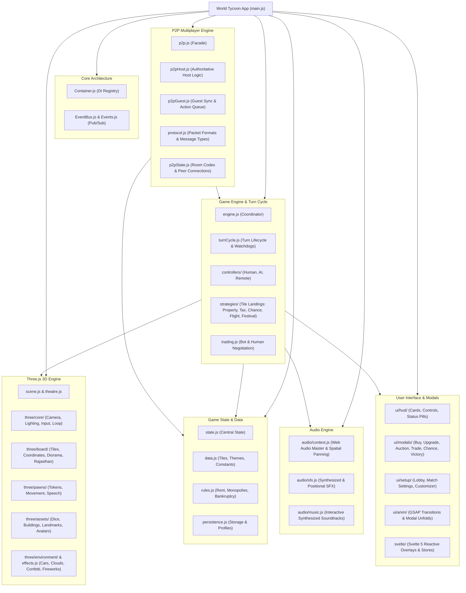
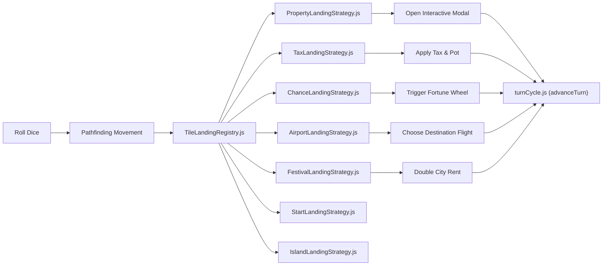
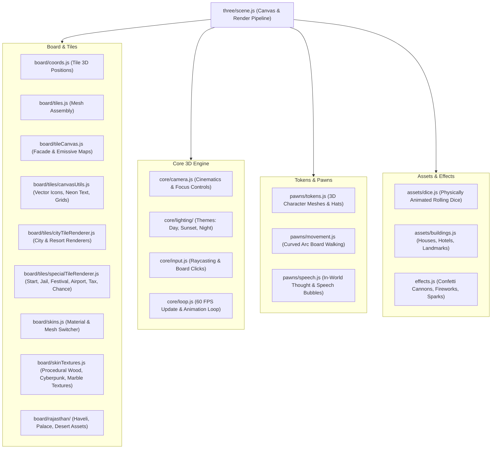
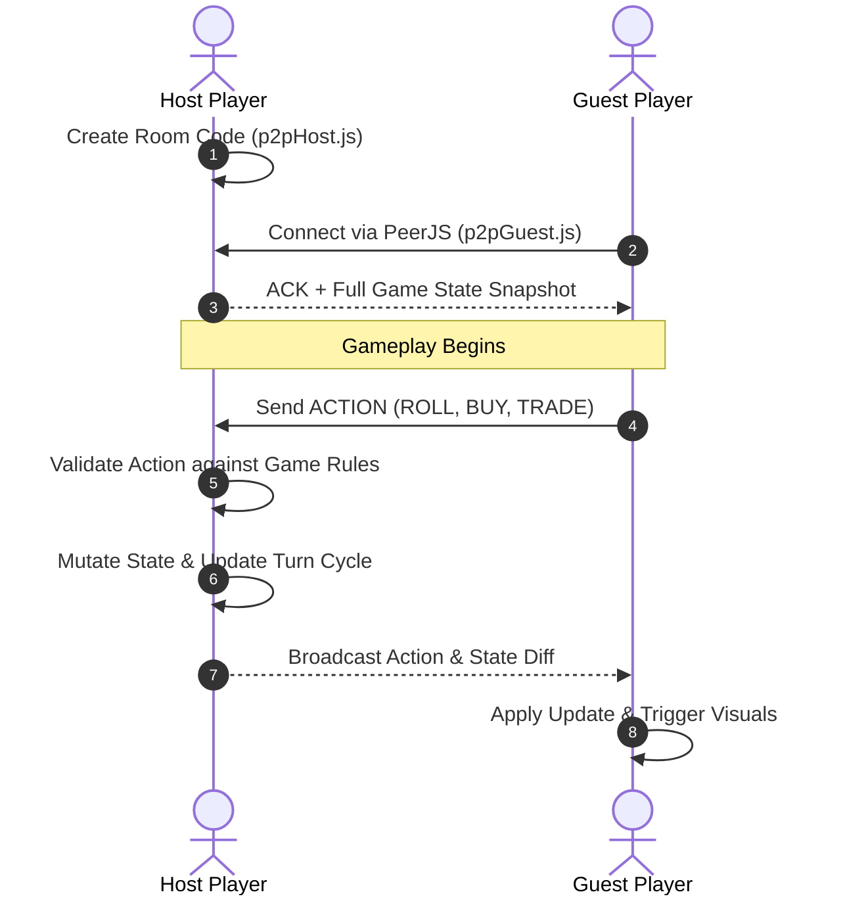

# World Tycoon: Codebase Architecture & Mindmap

> [!NOTE]
> This guide is the official architectural mindmap and quick-reference index for the World Tycoon codebase.
> **Rule**: Always check this file first when navigating the code. Whenever modules or architecture changes happen, update this document immediately.

---

## 1. High-Level System Mindmap

---

## 2. Directory & Module Navigation

### 2.1 Core Orchestration & State
- [`world-tycoon/src/main.js`](world-tycoon/src/main.js): App bootstrap, event wiring, canvas initialization, and lifecycle coordination.
- [`world-tycoon/src/core/Container.js`](world-tycoon/src/core/Container.js): Lightweight dependency injection container.
- [`world-tycoon/src/core/EventBus.js`](world-tycoon/src/core/EventBus.js): Central publish-subscribe message broker.
- [`world-tycoon/src/core/Events.js`](world-tycoon/src/core/Events.js): Global event name constants (`TURN_START`, `TILE_LANDED`, `DICE_ROLLED`, `MONOPOLY_TRIGGERED`).
- [`world-tycoon/src/game/state.js`](world-tycoon/src/game/state.js): Primary source of truth (`gameState`, `matchSettings`, `debugState`, `cycleGameSpeed`).
- [`world-tycoon/src/game/data.js`](world-tycoon/src/game/data.js): Tile metadata for World and Rajasthan boards, avatar definitions, color groups, and Chance tables.
- [`world-tycoon/src/game/rules.js`](world-tycoon/src/game/rules.js): Business rules for rent multipliers, full color group detection, side monopolies, and debt liquidation.
- [`world-tycoon/src/game/trading.js`](world-tycoon/src/game/trading.js): Trade evaluations, cash valuations, and AI bot counter-offers.

---

### 2.2 Turn Cycle & Landing Strategies
The turn cycle and tile interactions follow the Strategy and Factory patterns:

- [`world-tycoon/src/game/engine.js`](world-tycoon/src/game/engine.js): Coordinates turn transitions and state validation.
- [`world-tycoon/src/game/engine/turnCycle.js`](world-tycoon/src/game/engine/turnCycle.js): Turn timer watchdog, double rolls, turn advance, and game-over checks.
- [`world-tycoon/src/game/engine/landings.js`](world-tycoon/src/game/engine/landings.js): High-level landing dispatcher.
- [`world-tycoon/src/game/engine/strategies/ITileLandingStrategy.js`](world-tycoon/src/game/engine/strategies/ITileLandingStrategy.js): Base strategy interface.
- [`world-tycoon/src/game/engine/strategies/PropertyLandingStrategy.js`](world-tycoon/src/game/engine/strategies/PropertyLandingStrategy.js): Handles buy, buyout, upgrade, and rent transfers.
- [`world-tycoon/src/game/engine/strategies/TaxLandingStrategy.js`](world-tycoon/src/game/engine/strategies/TaxLandingStrategy.js): Net-worth and flat tax calculations.
- [`world-tycoon/src/game/engine/strategies/ChanceLandingStrategy.js`](world-tycoon/src/game/engine/strategies/ChanceLandingStrategy.js): Card draws and fortune spins.
- [`world-tycoon/src/game/engine/strategies/AirportLandingStrategy.js`](world-tycoon/src/game/engine/strategies/AirportLandingStrategy.js): World tour and flight mechanics.
- [`world-tycoon/src/game/engine/strategies/FestivalLandingStrategy.js`](world-tycoon/src/game/engine/strategies/FestivalLandingStrategy.js): Festival host selection and rent doubling.

---

### 2.3 Player Controllers (Polymorphic Design)
- [`world-tycoon/src/game/controllers/IPlayerController.js`](world-tycoon/src/game/controllers/IPlayerController.js): Base contract for turn action dispatch.
- [`world-tycoon/src/game/controllers/HumanPlayerController.js`](world-tycoon/src/game/controllers/HumanPlayerController.js): Hooks into DOM HUD buttons and touch inputs.
- [`world-tycoon/src/game/controllers/AIPlayerController.js`](world-tycoon/src/game/controllers/AIPlayerController.js): Heuristic decisions for buying, upgrading, and trading.
- [`world-tycoon/src/game/controllers/RemotePlayerController.js`](world-tycoon/src/game/controllers/RemotePlayerController.js): Proxies actions over WebRTC from remote players.
- [`world-tycoon/src/game/controllers/PlayerControllerFactory.js`](world-tycoon/src/game/controllers/PlayerControllerFactory.js): Instantiates correct controller based on slot config.

---

### 2.4 Three.js 3D Graphics Engine

- [`world-tycoon/src/three/scene.js`](world-tycoon/src/three/scene.js): Scene management, renderer initialization, and shadow map configuration.
- [`world-tycoon/src/three/core/camera.js`](world-tycoon/src/three/core/camera.js): Dynamic camera modes (isometric overview, pawn chase, modal zoom).
- [`world-tycoon/src/three/core/lighting/themes.js`](world-tycoon/src/three/core/lighting/themes.js): Lighting presets for Day, Sunset, and Cyberpunk/Night.
- [`world-tycoon/src/three/pawns/movement.js`](world-tycoon/src/three/pawns/movement.js): Hop and walk animations around board corners.
- [`world-tycoon/src/three/assets/dice.js`](world-tycoon/src/three/assets/dice.js): 3D dice rolling with face rotation calculations.
- [`world-tycoon/src/three/board/rajasthan/assembly.js`](world-tycoon/src/three/board/rajasthan/assembly.js): Rajasthan edition diorama with desert palace and animated camels.

---

### 2.5 Multiplayer & P2P Networking

- [`world-tycoon/src/network/p2p.js`](world-tycoon/src/network/p2p.js): Unified multiplayer API facade.
- [`world-tycoon/src/network/protocol.js`](world-tycoon/src/network/protocol.js): Packet schemas and action constants.
- [`world-tycoon/src/network/p2pHost.js`](world-tycoon/src/network/p2pHost.js): Authoritative host room server, validates turns, broadcasts snapshots, maintains signaling heartbeats (`startHostHeartbeat`), auto-reconnects on tab sleep, and handles room ID collisions.
- [`world-tycoon/src/network/p2pGuest.js`](world-tycoon/src/network/p2pGuest.js): Client synchronization, remote action queuing, 14-second watchdog connection timeout, progressive handshake status, and fast WebRTC ICE failure detection.
- [`world-tycoon/src/network/p2pState.js`](world-tycoon/src/network/p2pState.js): Connection status, peer references, room metadata, Anycast STUN servers list, Metered enterprise TURN relays (`ICE_SERVERS` with UDP, TCP, and TLS TURNS on ports 80/443), and heartbeat timers.

---

### 2.6 User Interface, Modals & HUD
- **Svelte 5 Declarative Architecture (`src/svelte/`)**:
  - `stores/hudStore.js`: Central reactive store for turn phases, timer, roll states, game speed, toasts, and audio volume.
  - `stores/modalStore.js`: Declarative modal state slices for all 13 game modals (Buy City, Upgrade City, Sell Cities, Auction, Portfolio, Rules, Victory, Wardrobe, Trade, Buyout, Inspector, Chance Wheel, and Festival Boost) with automatic DOM synchronization (`syncModalDom`).
  - `stores/lobbyStore.js`: Pre-game match setup store for player slots, host/peer badges, roles, and character selection.
  - `hud/`: Svelte HUD components (`TopBar.svelte`, `StatusPill.svelte`, `PlayerCards.svelte`, `GameHud.svelte`) mounted at `#svelte-hud-mount` with single-source-of-truth declarative DOM and top offset positioning.
  - `modals/`: Declarative modal views (`BuyCityModal.svelte`, `UpgradeCityModal.svelte`, `SellCitiesModal.svelte`, `AuctionModal.svelte`, `PortfolioModal.svelte`, `RulesModal.svelte`, `VictoryModal.svelte`, `WardrobeModal.svelte`, `TradeModal.svelte`, `BuyoutModal.svelte`, `InspectorModal.svelte`, `ChanceWheelModal.svelte` [with 3D dynamic ticker pin and victory celebration popup], `FestivalBoostModal.svelte`, `ModalsRoot.svelte`) mounted at `#svelte-modals-mount`.
  - `lobby/`: Declarative setup roster (`PlayerSetupCards.svelte`).
- **HUD Controllers**:
  - [`world-tycoon/src/ui/hud/controls.js`](world-tycoon/src/ui/hud/controls.js): Roll button, fast-forward toggle, and turn controls dispatching to `hudStore`.
  - [`world-tycoon/src/ui/hud/cards.js`](world-tycoon/src/ui/hud/cards.js): Player cash cards and status bars dispatching to `hudStore` without dual-rendering DOM collisions.
  - [`world-tycoon/src/ui/hud/statusPill.js`](world-tycoon/src/ui/hud/statusPill.js): Turn phase notification banner dispatching to `hudStore`.
- **Modals (Svelte-Driven)**:
  - [`world-tycoon/src/ui/modals/buyCity.js`](world-tycoon/src/ui/modals/buyCity.js): Property purchase prompt (driven by Svelte `BuyCityModal.svelte`).
  - [`world-tycoon/src/ui/modals/buyoutCity.js`](world-tycoon/src/ui/modals/buyoutCity.js): Acquisition buyout of opponent property (driven by Svelte `BuyoutModal.svelte`).
  - [`world-tycoon/src/ui/modals/upgradeCity.js`](world-tycoon/src/ui/modals/upgradeCity.js): Constructing villas, hotels, and landmarks (driven by Svelte `UpgradeCityModal.svelte`).
  - [`world-tycoon/src/ui/modals/sellRent.js`](world-tycoon/src/ui/modals/sellRent.js): Liquidating cities to satisfy rent debts or bankruptcy deficits (driven by Svelte `SellCitiesModal.svelte`).
  - [`world-tycoon/src/ui/modals/auction.js`](world-tycoon/src/ui/modals/auction.js): Public bidding arena when unowned land is passed on (driven by Svelte `AuctionModal.svelte`).
  - [`world-tycoon/src/ui/modals/inspector.js`](world-tycoon/src/ui/modals/inspector.js): Property inspection and player portfolio view (driven by Svelte `InspectorModal.svelte` and `PortfolioModal.svelte`).
  - [`world-tycoon/src/ui/modals/system.js`](world-tycoon/src/ui/modals/system.js): Official game rules and help guide (driven by Svelte `RulesModal.svelte`).
  - [`world-tycoon/src/ui/modals/victory.js`](world-tycoon/src/ui/modals/victory.js): Match recap, accolades, net worth chart, and stars rewards (driven by Svelte `VictoryModal.svelte`).
  - [`world-tycoon/src/ui/modals/trade.js`](world-tycoon/src/ui/modals/trade.js): Player-to-player property negotiation and bot proposals (driven by Svelte `TradeModal.svelte`).
  - [`world-tycoon/src/ui/modals/chanceWheel.js`](world-tycoon/src/ui/modals/chanceWheel.js): Interactive spinning wheel for fortune cards with ticker needle physics and 2.2s celebration popup (driven by Svelte `ChanceWheelModal.svelte`).
  - [`world-tycoon/src/ui/modals/chanceCanvas.js`](world-tycoon/src/ui/modals/chanceCanvas.js): 2D Canvas wheel rendering with right-side-up tangential badge orientation and vector icons.
  - [`world-tycoon/src/ui/modals/festivalBoost.js`](world-tycoon/src/ui/modals/festivalBoost.js): World festival rent boost and 3D breathing highlights (driven by Svelte `FestivalBoostModal.svelte`).
- **Setup & Wardrobe**:
  - [`world-tycoon/src/ui/setup/setupRoom.js`](world-tycoon/src/ui/setup/setupRoom.js): Lobby staging room and player configuration.
  - [`world-tycoon/src/ui/setup/matchSettingsUI.js`](world-tycoon/src/ui/setup/matchSettingsUI.js): Match customization panel.
  - [`world-tycoon/src/ui/wardrobe.js`](world-tycoon/src/ui/wardrobe.js): Unlockable hats, dice skins, and pedestals (driven by Svelte `WardrobeModal.svelte`).
- **Animation Engine (`src/ui/anim/`)**:
  - [`world-tycoon/src/ui/anim/events.js`](world-tycoon/src/ui/anim/events.js): Animation facade routing events to specialized submodules.
  - [`world-tycoon/src/ui/anim/banners.js`](world-tycoon/src/ui/anim/banners.js): Doubles comic banners, boarding pass zooms, monopoly ribbons, and hostile takeover stamps.
  - [`world-tycoon/src/ui/anim/celebrations.js`](world-tycoon/src/ui/anim/celebrations.js): Victory tally breakdown, festival pot golden rain fountain, and GO salary bill streams.
  - [`world-tycoon/src/ui/anim/jail.js`](world-tycoon/src/ui/anim/jail.js): Island detention iron bars slam and jailbreak scatter animations.
  - [`world-tycoon/src/ui/anim/interactions.js`](world-tycoon/src/ui/anim/interactions.js): Active turn switch spring punch, chance deck FLIP draw, HUD card spring absorb, bankruptcy quake, building upgrade bounce, trade handshake pop, and dice slingshot pullback.
- **Debug Suite**:
  - [`world-tycoon/src/game/debug/ui.js`](world-tycoon/src/game/debug/ui.js): Debug drawer controller and shortcuts.
  - [`world-tycoon/src/game/debug/debugPanelTemplate.js`](world-tycoon/src/game/debug/debugPanelTemplate.js): Modularized QA drawer template markup.

---

### 2.7 Audio Subsystem
- [`world-tycoon/src/game/audio/context.js`](world-tycoon/src/game/audio/context.js): Shared Web Audio `AudioContext`, master volume slider state, and 3D panner nodes.
- [`world-tycoon/src/game/audio/sfx.js`](world-tycoon/src/game/audio/sfx.js): Procedural synthesis for dice rolls, cash counts, button taps, and error chirps.
- [`world-tycoon/src/game/audio/music.js`](world-tycoon/src/game/audio/music.js): Algorithmic background music arrangements that adapt to match tension.

---

### 2.8 Build Tooling, Deployment & Analytics
- [`world-tycoon/tools/assemble-html.js`](world-tycoon/tools/assemble-html.js): Assembles modal templates into `index.html`.
- [`world-tycoon/tools/build-css.js`](world-tycoon/tools/build-css.js): Fast PostCSS and Tailwind compiler.
- [`vercel.json`](vercel.json) & [`world-tycoon/vercel.json`](world-tycoon/vercel.json): Vercel CI deployment configuration with automated Vite production builds.
- **Vercel Web Analytics (`@vercel/analytics`)**: Integrated into [`world-tycoon/src/main.js`](world-tycoon/src/main.js) via `inject()` and `track()`, capturing real-time page views and semantic game telemetry (`match_started`, `match_victory`) over `eventBus`.
- [`world-tycoon/package.json`](world-tycoon/package.json): NPM run scripts (`test`, `dev`, `build`, `typecheck`).
